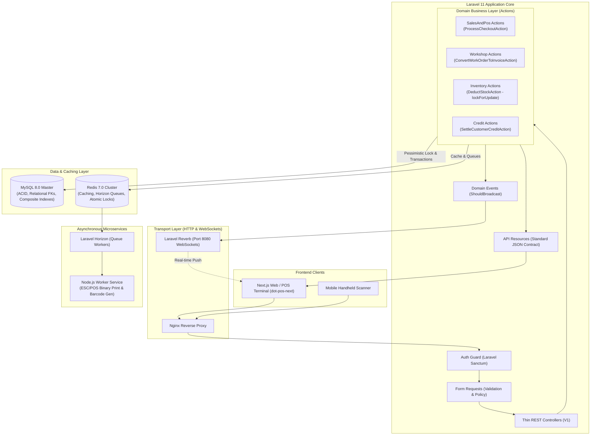

# Enterprise System Architecture Specification

## 1. Executive Overview

The **DOT Enterprise Backend** is a unified retail ERP, automotive workshop management, and high-concurrency cloud POS API built on **Laravel 11**, **PHP 8.3**, **MySQL 8.0**, and **Redis 7.0**. 

The architecture is engineered around the **Domain-Driven Modular (DDD-Lite) + Action Pattern**, ensuring strict boundary separation, testability, and enterprise scalability while completely avoiding the "Fat Controller" anti-pattern.



---

## 2. Layer Responsibilities & Design Patterns

### 2.1. Transport & Validation Layer (`app/Http/`)
* **Requests (`app/Http/Requests/V1/`):** Encapsulates input validation rules, custom error messages, and granular RBAC authorization before hitting any controller logic.
* **Controllers (`app/Http/Controllers/Api/V1/`):** Thin orchestrators. They inject dependencies, call the relevant Domain Action, and return structured `JsonResource` outputs.
* **Resources (`app/Http/Resources/V1/`):** Strictly transforms internal Eloquent models into consistent API payloads matching frontend TypeScript interfaces (e.g. `dot-pos-next/src/types/index.ts`).

### 2.2. Domain Business Layer (`app/Domains/{Domain}/`)
Each business domain is isolated into its own cohesive namespace:
* **`Workshop/`:** Vehicles, Fleets, Job Cards (Work Orders), Mechanics, Labor Commissions, Outsourced Parts.
* **`Inventory/`:** Product catalog, Multi-variants (Size, Color, UOM), OEM part numbers, Batch/Expiry, Stock adjustments.
* **`SalesAndPos/`:** Checkout engine, Cart calculations, Multi-tender split payments (Cash/KPay/Card/Credit), Parked/Held orders, Sales returns.
* **`PricingAndPromotions/`:** Multi-tier price lists (Retail, Wholesale, Fleet), Volume breaks, Promotional vouchers, Loyalty points.
* **`CreditAndLedger/`:** Customer receivables, Credit limits, Partial/Full debt settlement ledger.
* **`Purchasing/`:** Supplier management, Purchase orders, Purchase returns.
* **`SecurityAndAudit/`:** Staff users, PIN verification, Roles & Permissions (RBAC), Immutable Audit Logs.

### 2.3. Domain Actions Pattern (Single Responsibility Principle)
Every state-altering business operation is encapsulated in a dedicated Action class with an `execute()` method.
Example: `ProcessCheckoutAction` coordinates:
1. `DeductStockAction` with `lockForUpdate()`
2. `SalesOrder` record creation inside `DB::transaction()`
3. `PaymentSplit` records creation
4. `AccrueLoyaltyPointsAction`
5. `OrderCompletedEvent` dispatch

---

## 3. High-Concurrency & Data Consistency Safeguards

### 3.1. Pessimistic Row Locking (`lockForUpdate()`)
In high-throughput POS environments, multiple cashiers can attempt to ring up the last unit of a product simultaneously. To prevent race conditions:
```php
$product = Product::where('id', $productId)->lockForUpdate()->firstOrFail();
if ($product->stock < $qty) {
    throw new InsufficientStockException("Item '{$product->name}' is out of stock.");
}
$product->decrement('stock', $qty);
```

### 3.2. Idempotency for Offline-to-Cloud Sync
For edge POS terminals operating in unstable network environments, the sync endpoint accepts an `idempotency_key` (UUID v4). Re-transmitted requests are detected and return the previously committed receipt without double-charging or duplicate inventory deduction.

---

## 4. Real-Time Broadcasting (Laravel Reverb)

* **Engine:** Laravel Reverb (PHP native WebSocket daemon running on port 8080).
* **Broadcasting Protocol:** Pusher protocol compatible, seamlessly listened to by frontend `laravel-echo`.
* **Channels:**
  * `stock.channel` (Public/Private): Instant broadcast on stock changes so other POS terminals immediately reflect current quantity.
  * `workshop.bay` (Private): Work order status transitions (e.g., Intake -> In Progress -> QC Ready -> Invoiced).
  * `pos.orders` (Presence): Tracks live active cashiers across counters.

---

## 5. Asynchronous Processing & Microservice Bridge

Heavy operations are offloaded to Redis queues and monitored through **Laravel Horizon**:
1. **Invoice PDF Generation:** Rendered asynchronously in the background.
2. **Node.js Microservice Worker:**
   * High-speed barcode/QR code generation (`bwip-js`).
   * ESC/POS raw byte formatting for thermal receipt hardware.
   * Communication over Redis Pub/Sub channels (`pos:print-job`, `pos:barcode-gen`).
