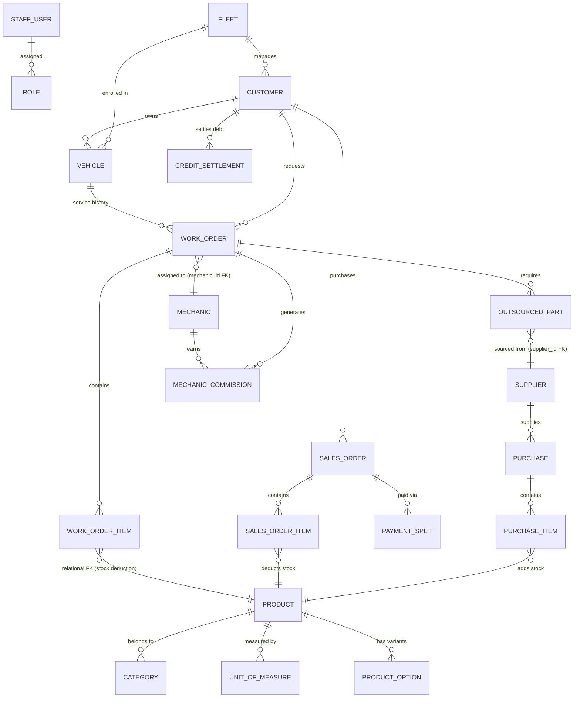

# Relational Database Schema & Migrations Specification

## 1. Schema Overview & Relational Integrity Blueprint

This document details the relational database design for **DOT Enterprise ERP, Workshop & POS**, addressing and completely resolving all the relational gaps identified in the architecture audit.

---

## 2. Table Definitions

### 2.1. Authentication, Staff & RBAC
* **`roles`**
  * `id` (BIGINT, PK, AUTO_INCREMENT)
  * `code` (VARCHAR(50), UNIQUE) — e.g. `ADMIN`, `SUPERVISOR`, `CASHIER`, `MECHANIC`, `INVENTORY_MGR`
  * `name` (VARCHAR(100))
  * `permissions` (JSON) — Granular module-level flags `{ "pos": {"allowDiscount": true, "voidInvoice": false}, ... }`
  * `badge_color` (VARCHAR(20))
  * `created_at`, `updated_at` (TIMESTAMP)

* **`staff_users`**
  * `id` (BIGINT, PK, AUTO_INCREMENT)
  * `name` (VARCHAR(150))
  * `email` (VARCHAR(191), UNIQUE)
  * `phone` (VARCHAR(50))
  * `role_id` (BIGINT, FK -> `roles.id`)
  * `pin_hash` (VARCHAR(255)) — 4 or 6-digit hashed PIN for fast terminal login
  * `password` (VARCHAR(255), NULLABLE)
  * `status` (ENUM('Active', 'Suspended', 'On Leave'), DEFAULT 'Active')
  * `workstation` (VARCHAR(100), NULLABLE)
  * `last_login_at` (TIMESTAMP, NULLABLE)
  * `created_at`, `updated_at` (TIMESTAMP)

* **`audit_logs`**
  * `id` (BIGINT, PK, AUTO_INCREMENT)
  * `staff_id` (BIGINT, FK -> `staff_users.id`)
  * `module` (ENUM('POS', 'INVENTORY', 'WORKSHOP', 'FINANCES', 'PURCHASES', 'ROLES', 'AUTH', 'SYSTEM'))
  * `action` (ENUM('CREATE', 'UPDATE', 'DELETE', 'VOID', 'OVERRIDE', 'EXPORT', 'LOGIN', 'LOGOUT', 'ADJUST'))
  * `severity` (ENUM('INFO', 'WARNING', 'CRITICAL', 'SECURITY'))
  * `resource_type` (VARCHAR(100))
  * `resource_id` (VARCHAR(100))
  * `description` (TEXT)
  * `diffs` (JSON, NULLABLE) — Before and After values
  * `ip_address` (VARCHAR(45), NULLABLE)
  * `created_at` (TIMESTAMP)

---

### 2.2. Customers, Vehicles & Fleets
* **`fleets`**
  * `id` (BIGINT, PK, AUTO_INCREMENT)
  * `name` (VARCHAR(150)) — e.g. "KBZ Logistics VIP Fleet"
  * `type` (ENUM('Family VIP', 'Commercial Logistics', 'Corporate / Executive', 'Taxi / Rental'))
  * `credit_limit` (DECIMAL(14,2), DEFAULT 0.00)
  * `notes` (TEXT, NULLABLE)
  * `created_at`, `updated_at` (TIMESTAMP)

* **`customers`**
  * `id` (BIGINT, PK, AUTO_INCREMENT)
  * `name` (VARCHAR(150))
  * `phone` (VARCHAR(50), INDEX)
  * `email` (VARCHAR(191), NULLABLE)
  * `address` (TEXT, NULLABLE)
  * `fleet_id` (BIGINT, NULLABLE, FK -> `fleets.id`, ON DELETE SET NULL)
  * `tier` (ENUM('Standard', 'Silver', 'VIP', 'Fleet'), DEFAULT 'Standard')
  * `price_list_id` (BIGINT, NULLABLE, FK -> `price_lists.id`)
  * `due_amount` (DECIMAL(14,2), DEFAULT 0.00) — Current outstanding receivable
  * `credit_limit` (DECIMAL(14,2), DEFAULT 0.00)
  * `loyalty_points` (INT, DEFAULT 0)
  * `created_at`, `updated_at` (TIMESTAMP)

* **`vehicles`**
  * `id` (BIGINT, PK, AUTO_INCREMENT)
  * `plate_number` (VARCHAR(50), UNIQUE, INDEX) — e.g. "3I/4411"
  * `customer_id` (BIGINT, FK -> `customers.id`, ON DELETE RESTRICT)
  * `fleet_id` (BIGINT, NULLABLE, FK -> `fleets.id`, ON DELETE SET NULL)
  * `make` (VARCHAR(100)) — e.g. "Toyota"
  * `model` (VARCHAR(100)) — e.g. "Alphard Executive Lounge"
  * `year` (INT, NULLABLE)
  * `vin` (VARCHAR(100), NULLABLE, INDEX) — Chassis / Frame No
  * `engine_no` (VARCHAR(100), NULLABLE)
  * `transmission` (VARCHAR(50), DEFAULT 'Automatic')
  * `fuel_type` (VARCHAR(50), DEFAULT 'Petrol')
  * `current_mileage` (INT, DEFAULT 0)
  * `created_at`, `updated_at` (TIMESTAMP)

---

### 2.3. Products, Catalog & Inventory
* **`categories`**
  * `id` (BIGINT, PK, AUTO_INCREMENT)
  * `code` (VARCHAR(50), UNIQUE)
  * `name` (VARCHAR(100))
  * `description` (TEXT, NULLABLE)
  * `created_at`, `updated_at` (TIMESTAMP)

* **`units_of_measure`**
  * `id` (BIGINT, PK, AUTO_INCREMENT)
  * `name` (VARCHAR(50), UNIQUE) — e.g. "Piece", "Liter", "Box", "Set"
  * `created_at`, `updated_at` (TIMESTAMP)

* **`products`**
  * `id` (BIGINT, PK, AUTO_INCREMENT)
  * `category_id` (BIGINT, FK -> `categories.id`)
  * `uom_id` (BIGINT, FK -> `units_of_measure.id`)
  * `supplier_id` (BIGINT, NULLABLE, FK -> `suppliers.id`)
  * `name` (VARCHAR(200), INDEX)
  * `barcode` (VARCHAR(100), UNIQUE, INDEX)
  * `oem_part_no` (VARCHAR(100), NULLABLE, INDEX)
  * `car_fitment` (TEXT, NULLABLE) — Compatible car makes/models
  * `bin_location` (VARCHAR(50), NULLABLE) — Warehouse shelf coordinate
  * `cost_price` (DECIMAL(14,2), DEFAULT 0.00)
  * `sell_price` (DECIMAL(14,2), DEFAULT 0.00)
  * `wholesale_price` (DECIMAL(14,2), NULLABLE)
  * `stock` (INT, DEFAULT 0) — Master inventory quantity
  * `min_stock` (INT, DEFAULT 5) — Low stock threshold
  * `is_labor` (BOOLEAN, DEFAULT FALSE) — For service/repair labor charges
  * `is_outsourced` (BOOLEAN, DEFAULT FALSE)
  * `has_variants` (BOOLEAN, DEFAULT FALSE) — Indicates multi-axis variants matrix exists
  * `created_at`, `updated_at` (TIMESTAMP)

* **`attributes`** (Master Variant Attributes)
  * `id` (BIGINT, PK, AUTO_INCREMENT)
  * `code` (VARCHAR(50), UNIQUE, INDEX) — e.g. "SIZE", "COLOR"
  * `name` (VARCHAR(100)) — e.g. "Clothing Size", "Color"
  * `description` (VARCHAR(255), NULLABLE)
  * `created_at`, `updated_at` (TIMESTAMP)

* **`attribute_values`** (Discrete Attribute Options)
  * `id` (BIGINT, PK, AUTO_INCREMENT)
  * `attribute_id` (BIGINT, FK -> `attributes.id`, ON DELETE CASCADE)
  * `value` (VARCHAR(100)) — e.g. "XL", "M", "Racing Red"
  * `color_hex` (VARCHAR(20), NULLABLE) — Hex color code, e.g. "#EF4444"
  * `sort_order` (INT, DEFAULT 0)
  * `created_at`, `updated_at` (TIMESTAMP)
  * UNIQUE (`attribute_id`, `value`)

* **`product_variants`** (Multi-Dimensional SKU Permutations)
  * `id` (BIGINT, PK, AUTO_INCREMENT)
  * `product_id` (BIGINT, FK -> `products.id`, ON DELETE CASCADE)
  * `sku` (VARCHAR(100), UNIQUE, INDEX) — Structured SKU, e.g. "OVERALL-S-RED"
  * `barcode` (VARCHAR(100), UNIQUE, NULLABLE, INDEX) — Direct scanner barcode, e.g. "OVERALL-V001"
  * `price` (DECIMAL(14,2))
  * `cost_price` (DECIMAL(14,2), DEFAULT 0.00)
  * `stock` (INT, DEFAULT 0) — Variant-specific stock level
  * `image_url` (VARCHAR(255), NULLABLE)
  * `is_active` (BOOLEAN, DEFAULT TRUE)
  * `created_at`, `updated_at` (TIMESTAMP)
  * INDEX (`product_id`, `is_active`)

* **`variant_attribute_values`** (EAV Matrix Pivot)
  * `id` (BIGINT, PK, AUTO_INCREMENT)
  * `product_variant_id` (BIGINT, FK -> `product_variants.id`, ON DELETE CASCADE)
  * `attribute_value_id` (BIGINT, FK -> `attribute_values.id`, ON DELETE CASCADE)
  * `created_at`, `updated_at` (TIMESTAMP)
  * UNIQUE (`product_variant_id`, `attribute_value_id`)

* **`product_uom_conversions`** (Multi-UOM Packaging Conversion Rules)
  * `id` (BIGINT, PK, AUTO_INCREMENT)
  * `product_id` (BIGINT, FK -> `products.id`, ON DELETE CASCADE)
  * `uom_id` (BIGINT, FK -> `units_of_measure.id`, ON DELETE CASCADE) — Packaging UOM (e.g. Box, Drum, Carton)
  * `conversion_factor` (DECIMAL(12,4)) — Ratio to base unit (e.g. 10.00 for 10 pcs/box)
  * `barcode` (VARCHAR(100), UNIQUE, NULLABLE, INDEX) — Dedicated packaging barcode for POS scanning
  * `sell_price` (DECIMAL(14,2), NULLABLE) — Wholesale/bulk packaging sell price
  * `cost_price` (DECIMAL(14,2), NULLABLE) — Bulk packaging cost
  * `is_active` (BOOLEAN, DEFAULT TRUE)
  * `created_at`, `updated_at` (TIMESTAMP)
  * UNIQUE (`product_id`, `uom_id`)

* **`product_vehicle_fitments`** (Automotive Vehicle Compatibility Matrix)
  * `id` (BIGINT, PK, AUTO_INCREMENT)
  * `product_id` (BIGINT, FK -> `products.id`, ON DELETE CASCADE)
  * `make` (VARCHAR(100), INDEX) — e.g. "TOYOTA", "HONDA", "MAZDA"
  * `model` (VARCHAR(100), INDEX) — e.g. "HILUX REVO", "CIVIC", "CX-5"
  * `year_start` (SMALLINT UNSIGNED, NULLABLE, INDEX) — e.g. 2016
  * `year_end` (SMALLINT UNSIGNED, NULLABLE, INDEX) — e.g. 2024
  * `engine_code` (VARCHAR(100), NULLABLE, INDEX) — e.g. "1GD-FTV", "2ZR-FE"
  * `chassis_code` (VARCHAR(100), NULLABLE) — e.g. "GUN126"
  * `notes` (TEXT, NULLABLE) — Special installation/fitting instructions
  * `created_at`, `updated_at` (TIMESTAMP)
  * INDEX (`make`, `model`, `year_start`, `year_end`)

* **`product_options`** (Variants)
  * `id` (BIGINT, PK, AUTO_INCREMENT)
  * `product_id` (BIGINT, FK -> `products.id`, ON DELETE CASCADE)
  * `name` (VARCHAR(100)) — e.g. "4 Liter Can", "XL", "Red"
  * `barcode` (VARCHAR(100), NULLABLE, INDEX)
  * `sku` (VARCHAR(100), NULLABLE)
  * `price` (DECIMAL(14,2))
  * `cost_price` (DECIMAL(14,2), DEFAULT 0.00)
  * `stock` (INT, DEFAULT 0)
  * `batch_no` (VARCHAR(100), NULLABLE)
  * `expiry_date` (DATE, NULLABLE)
  * `created_at`, `updated_at` (TIMESTAMP)

* **`stock_adjustments`**
  * `id` (BIGINT, PK, AUTO_INCREMENT)
  * `product_id` (BIGINT, FK -> `products.id`)
  * `type` (ENUM('Cycle Count', 'Damage / Scrap', 'Found Stock', 'Physical Audit', 'Supplier Return'))
  * `prev_stock` (INT)
  * `adjusted_qty` (INT) — E.g. -2, +5
  * `new_stock` (INT)
  * `reason` (TEXT, NULLABLE)
  * `staff_id` (BIGINT, FK -> `staff_users.id`)
  * `created_at` (TIMESTAMP)

* **`warehouses`** (Physical Branch Locations & Central Warehouses)
  * `id` (BIGINT, PK, AUTO_INCREMENT)
  * `code` (VARCHAR(50), UNIQUE, INDEX) — e.g. "WH-MAIN-01", "BR-HLEDAN-02"
  * `name` (VARCHAR(150))
  * `type` (VARCHAR(50), DEFAULT 'Branch Counter')
  * `address` (TEXT, NULLABLE)
  * `phone` (VARCHAR(50), NULLABLE)
  * `is_central` (BOOLEAN, DEFAULT FALSE)
  * `is_active` (BOOLEAN, DEFAULT TRUE)
  * `created_at`, `updated_at` (TIMESTAMP)

* **`warehouse_stocks`** (Physical Inventory Balances per Location)
  * `id` (BIGINT, PK, AUTO_INCREMENT)
  * `warehouse_id` (BIGINT, FK -> `warehouses.id`, ON DELETE CASCADE)
  * `product_id` (BIGINT, FK -> `products.id`, ON DELETE CASCADE)
  * `product_option_id` (BIGINT, NULLABLE, FK -> `product_options.id`, ON DELETE CASCADE)
  * `stock_qty` (INT, DEFAULT 0, INDEX)
  * `min_alert_qty` (INT, DEFAULT 5)
  * `bin_location` (VARCHAR(100), NULLABLE)
  * `created_at`, `updated_at` (TIMESTAMP)

* **`stock_transfers`** (Two-Step Inter-Branch Transfer Orders)
  * `id` (BIGINT, PK, AUTO_INCREMENT)
  * `transfer_no` (VARCHAR(50), UNIQUE, INDEX) — e.g. "TRF-20261030-0001"
  * `source_warehouse_id` (BIGINT, FK -> `warehouses.id`)
  * `destination_warehouse_id` (BIGINT, FK -> `warehouses.id`)
  * `requested_by` (BIGINT, FK -> `staff_users.id`)
  * `approved_by` (BIGINT, NULLABLE, FK -> `staff_users.id`)
  * `received_by` (BIGINT, NULLABLE, FK -> `staff_users.id`)
  * `status` (ENUM('Draft', 'In Transit', 'Received', 'Cancelled'), DEFAULT 'Draft', INDEX)
  * `notes` (TEXT, NULLABLE)
  * `dispatched_at` (TIMESTAMP, NULLABLE)
  * `received_at` (TIMESTAMP, NULLABLE)
  * `created_at`, `updated_at` (TIMESTAMP)

* **`stock_transfer_items`** (Transfer Line Items)
  * `id` (BIGINT, PK, AUTO_INCREMENT)
  * `stock_transfer_id` (BIGINT, FK -> `stock_transfers.id`, ON DELETE CASCADE)
  * `product_id` (BIGINT, FK -> `products.id`)
  * `product_option_id` (BIGINT, NULLABLE, FK -> `product_options.id`)
  * `qty_requested` (INT)
  * `qty_dispatched` (INT, DEFAULT 0)
  * `qty_received` (INT, DEFAULT 0)
  * `notes` (VARCHAR(255), NULLABLE)
  * `created_at`, `updated_at` (TIMESTAMP)

---

### 2.4. Workshop, Work Orders & Mechanics
* **`mechanics`**
  * `id` (BIGINT, PK, AUTO_INCREMENT)
  * `name` (VARCHAR(150))
  * `phone` (VARCHAR(50))
  * `specialization` (VARCHAR(100)) — e.g. "Engine & Transmission Overhaul", "Auto Electrical"
  * `commission_rate` (DECIMAL(5,2), DEFAULT 15.00) — Percentage of labor fee
  * `status` (ENUM('Active', 'On Leave', 'Inactive'), DEFAULT 'Active')
  * `created_at`, `updated_at` (TIMESTAMP)

* **`work_orders`** (Job Cards)
  * `id` (BIGINT, PK, AUTO_INCREMENT)
  * `job_card_no` (VARCHAR(50), UNIQUE, INDEX) — e.g. "JC-2026-0042"
  * `customer_id` (BIGINT, FK -> `customers.id`)
  * `vehicle_id` (BIGINT, FK -> `vehicles.id`)
  * `fleet_id` (BIGINT, NULLABLE, FK -> `fleets.id`)
  * `assigned_mechanic_id` (BIGINT, NULLABLE, FK -> `mechanics.id`)
  * `bay` (VARCHAR(50), DEFAULT 'Bay 1')
  * `priority` (ENUM('Normal', 'High', 'Urgent'), DEFAULT 'Normal')
  * `status` (ENUM('Intake / Estimate', 'In Progress', 'Waiting for Parts', 'QC & Ready', 'Completed / Invoiced', 'Cancelled'), DEFAULT 'Intake / Estimate', INDEX)
  * `complaint` (TEXT) — Customer reported symptoms
  * `mileage_in` (INT, DEFAULT 0)
  * `labor_fee` (DECIMAL(14,2), DEFAULT 0.00)
  * `parts_total` (DECIMAL(14,2), DEFAULT 0.00)
  * `total_amount` (DECIMAL(14,2), DEFAULT 0.00)
  * `sales_order_id` (BIGINT, NULLABLE, FK -> `sales_orders.id`) — Generated invoice reference
  * `created_at`, `updated_at` (TIMESTAMP)

* **`work_order_items`**
  * `id` (BIGINT, PK, AUTO_INCREMENT)
  * `work_order_id` (BIGINT, FK -> `work_orders.id`, ON DELETE CASCADE)
  * `product_id` (BIGINT, FK -> `products.id`) — **Crucial FK for Real Stock Deduction**
  * `uom_conversion_id` (BIGINT, NULLABLE, FK -> `product_uom_conversions.id`, ON DELETE SET NULL)
  * `uom_id` (BIGINT, NULLABLE, FK -> `units_of_measure.id`, ON DELETE SET NULL)
  * `conversion_factor` (DECIMAL(12,4), NULLABLE)
  * `name` (VARCHAR(200))
  * `qty` (INT, DEFAULT 1)
  * `unit_price` (DECIMAL(14,2))
  * `cost_price` (DECIMAL(14,2), DEFAULT 0.00)
  * `subtotal` (DECIMAL(14,2))
  * `is_outsourced` (BOOLEAN, DEFAULT FALSE)
  * `created_at`, `updated_at` (TIMESTAMP)

* **`outsourced_parts`**
  * `id` (BIGINT, PK, AUTO_INCREMENT)
  * `work_order_id` (BIGINT, FK -> `work_orders.id`, ON DELETE CASCADE)
  * `supplier_id` (BIGINT, FK -> `suppliers.id`) — **Crucial FK to Master Suppliers**
  * `part_name` (VARCHAR(200))
  * `cost_price` (DECIMAL(14,2)) — Shop acquisition cost
  * `bill_price` (DECIMAL(14,2)) — Billed to customer
  * `status` (ENUM('Ordered', 'In Transit', 'Received & Fitted', 'Cancelled'), DEFAULT 'Ordered')
  * `payment_status` (ENUM('Unpaid', 'Paid'), DEFAULT 'Unpaid')
  * `created_at`, `updated_at` (TIMESTAMP)

* **`mechanic_commissions`**
  * `id` (BIGINT, PK, AUTO_INCREMENT)
  * `mechanic_id` (BIGINT, FK -> `mechanics.id`)
  * `work_order_id` (BIGINT, FK -> `work_orders.id`)
  * `labor_amount` (DECIMAL(14,2))
  * `commission_rate` (DECIMAL(5,2)) — e.g. 20.00%
  * `earned_amount` (DECIMAL(14,2)) — Calculated commission
  * `status` (ENUM('Pending', 'Paid'), DEFAULT 'Pending', INDEX)
  * `paid_at` (TIMESTAMP, NULLABLE)
  * `created_at`, `updated_at` (TIMESTAMP)

---

### 2.5. Sales, POS Orders & Multi-Tender Payments
* **`pos_sessions`** (Cash Register Shift Sessions)
  * `id` (BIGINT, PK, AUTO_INCREMENT)
  * `session_no` (VARCHAR(50), UNIQUE, INDEX) — e.g. "SHIFT-20261030-0001"
  * `cashier_id` (BIGINT, FK -> `staff_users.id`)
  * `terminal_id` (VARCHAR(50), INDEX)
  * `warehouse_id` (BIGINT, NULLABLE, FK -> `warehouses.id`)
  * `opening_float` (DECIMAL(14,2), DEFAULT 0.00)
  * `status` (ENUM('open', 'closed'), DEFAULT 'open', INDEX)
  * `opened_at` (TIMESTAMP)
  * `closed_at` (TIMESTAMP, NULLABLE)
  * `counted_cash` (DECIMAL(14,2), NULLABLE) — Blind count on close
  * `expected_cash` (DECIMAL(14,2), NULLABLE) — opening_float + cash_sales - cash_refunds
  * `cash_variance` (DECIMAL(14,2), NULLABLE) — counted_cash - expected_cash (Over/Short)
  * `total_sales`, `total_refunds`, `cash_sales`, `kpay_sales`, `wave_sales`, `card_sales`, `credit_sales` (DECIMAL(14,2))
  * `opening_notes`, `closing_notes` (TEXT, NULLABLE)
  * `created_at`, `updated_at` (TIMESTAMP)

* **`sales_orders`** (Invoices)
  * `id` (BIGINT, PK, AUTO_INCREMENT)
  * `order_no` (VARCHAR(50), UNIQUE, INDEX) — e.g. "INV-20261030-001"
  * `customer_id` (BIGINT, FK -> `customers.id`)
  * `vehicle_id` (BIGINT, NULLABLE, FK -> `vehicles.id`)
  * `cashier_id` (BIGINT, FK -> `staff_users.id`)
  * `pos_session_id` (BIGINT, NULLABLE, FK -> `pos_sessions.id`, ON DELETE SET NULL)
  * `subtotal` (DECIMAL(14,2))
  * `labor_total` (DECIMAL(14,2), DEFAULT 0.00)
  * `discount_amount` (DECIMAL(14,2), DEFAULT 0.00)
  * `tax_amount` (DECIMAL(14,2), DEFAULT 0.00)
  * `total_amount` (DECIMAL(14,2))
  * `paid_amount` (DECIMAL(14,2))
  * `change_amount` (DECIMAL(14,2), DEFAULT 0.00) — Overpayment change returned
  * `due_amount` (DECIMAL(14,2), DEFAULT 0.00) — If sold on credit
  * `points_earned` (INT, DEFAULT 0)
  * `points_redeemed` (INT, DEFAULT 0)
  * `status` (ENUM('Completed', 'Pending', 'Voided', 'Returned'), DEFAULT 'Completed', INDEX)
  * `idempotency_key` (VARCHAR(100), NULLABLE, UNIQUE, INDEX) — Offline sync safeguard
  * `created_at`, `updated_at` (TIMESTAMP)

* **`sales_order_items`**
  * `id` (BIGINT, PK, AUTO_INCREMENT)
  * `sales_order_id` (BIGINT, FK -> `sales_orders.id`, ON DELETE CASCADE)
  * `product_id` (BIGINT, FK -> `products.id`)
  * `product_option_id` (BIGINT, NULLABLE, FK -> `product_options.id`)
  * `product_variant_id` (BIGINT, NULLABLE, FK -> `product_variants.id`, ON DELETE SET NULL)
  * `uom_conversion_id` (BIGINT, NULLABLE, FK -> `product_uom_conversions.id`, ON DELETE SET NULL)
  * `uom_id` (BIGINT, NULLABLE, FK -> `units_of_measure.id`, ON DELETE SET NULL)
  * `conversion_factor` (DECIMAL(12,4), NULLABLE)
  * `packaging_qty` (INT, NULLABLE)
  * `name` (VARCHAR(200))
  * `qty` (INT)
  * `unit_price` (DECIMAL(14,2))
  * `cost_price` (DECIMAL(14,2))
  * `subtotal` (DECIMAL(14,2))
  * `created_at`, `updated_at` (TIMESTAMP)

* **`payment_splits`** (Multi-Tender)
  * `id` (BIGINT, PK, AUTO_INCREMENT)
  * `sales_order_id` (BIGINT, FK -> `sales_orders.id`, ON DELETE CASCADE)
  * `method` (ENUM('Cash', 'KPay', 'WavePay', 'Card', 'Credit', 'Bank Transfer'))
  * `amount` (DECIMAL(14,2))
  * `status` (VARCHAR(30), DEFAULT 'completed', INDEX) — 'pending', 'completed', 'failed', 'refunded'
  * `gateway_provider` (VARCHAR(50), NULLABLE) — 'kbzpay', 'wavepay', 'cash', 'card'
  * `reference_no` (VARCHAR(100), NULLABLE) — e.g. KPay Transaction ID
  * `gateway_payload` (JSON, NULLABLE)
  * `created_at` (TIMESTAMP)

* **`payment_transactions`** (Dynamic QR & Webhook Lifecycle)
  * `id` (BIGINT, PK, AUTO_INCREMENT)
  * `transaction_no` (VARCHAR(60), UNIQUE, INDEX) — e.g. "TXN-20261030-0001"
  * `pos_session_id` (BIGINT, NULLABLE, FK -> `pos_sessions.id`)
  * `sales_order_id` (BIGINT, NULLABLE, FK -> `sales_orders.id`)
  * `provider` (VARCHAR(50), INDEX) — 'kbzpay', 'wavepay', 'cbpay'
  * `payment_method` (VARCHAR(50), DEFAULT 'QR')
  * `amount` (DECIMAL(14,2))
  * `currency` (VARCHAR(10), DEFAULT 'MMK')
  * `qr_payload` (TEXT, NULLABLE) — MMQR string or deeplink
  * `status` (VARCHAR(30), DEFAULT 'pending', INDEX) — 'pending', 'successful', 'failed', 'expired'
  * `gateway_ref` (VARCHAR(100), NULLABLE, INDEX) — Prepay ID / External order ref
  * `metadata` (JSON, NULLABLE)
  * `expires_at` (TIMESTAMP, NULLABLE)
  * `created_at`, `updated_at` (TIMESTAMP)

* **`credit_settlements`**
  * `id` (BIGINT, PK, AUTO_INCREMENT)
  * `receipt_no` (VARCHAR(50), UNIQUE, INDEX)
  * `customer_id` (BIGINT, FK -> `customers.id`)
  * `amount` (DECIMAL(14,2))
  * `payment_method` (VARCHAR(50))
  * `note` (TEXT, NULLABLE)
  * `cashier_id` (BIGINT, FK -> `staff_users.id`)
  * `pos_session_id` (BIGINT, NULLABLE, FK -> `pos_sessions.id`, ON DELETE SET NULL)
  * `created_at` (TIMESTAMP)

* **`sales_returns`** (Sales Returns & Refunds Master)
  * `id` (BIGINT, PK, AUTO_INCREMENT)
  * `return_no` (VARCHAR(50), UNIQUE, INDEX) — e.g. "RET-20261030-0001"
  * `sales_order_id` (BIGINT, FK -> `sales_orders.id`, ON DELETE RESTRICT)
  * `customer_id` (BIGINT, FK -> `customers.id`, ON DELETE RESTRICT)
  * `cashier_id` (BIGINT, FK -> `staff_users.id`, ON DELETE RESTRICT)
  * `total_refund_amount` (DECIMAL(14,2))
  * `refund_method` (VARCHAR(50)) — Cash, Credit Note, KBZPay, Card Reversal, Credit Adjusted
  * `refund_reference` (VARCHAR(100), NULLABLE)
  * `reason` (VARCHAR(255))
  * `status` (ENUM('Pending Inspection', 'Restocked', 'Refunded', 'Credit Adjusted', 'Rejected'), DEFAULT 'Restocked', INDEX)
  * `notes` (TEXT, NULLABLE)
  * `points_deducted` (INT, DEFAULT 0)
  * `created_at`, `updated_at` (TIMESTAMP)

* **`sales_return_items`** (Itemized Returned Lines)
  * `id` (BIGINT, PK, AUTO_INCREMENT)
  * `sales_return_id` (BIGINT, FK -> `sales_returns.id`, ON DELETE CASCADE)
  * `sales_order_item_id` (BIGINT, FK -> `sales_order_items.id`, ON DELETE RESTRICT)
  * `product_id` (BIGINT, FK -> `products.id`, ON DELETE RESTRICT)
  * `product_option_id` (BIGINT, NULLABLE, FK -> `product_options.id`, ON DELETE SET NULL)
  * `product_variant_id` (BIGINT, NULLABLE, FK -> `product_variants.id`, ON DELETE SET NULL)
  * `qty` (INT)
  * `unit_price` (DECIMAL(14,2))
  * `refund_subtotal` (DECIMAL(14,2))
  * `item_condition` (ENUM('Sellable', 'Damaged', 'Defective', 'Scrap'), DEFAULT 'Sellable')
  * `restocked` (BOOLEAN, DEFAULT TRUE)
  * `created_at`, `updated_at` (TIMESTAMP)

---

### 2.6. Purchasing & Suppliers
* **`suppliers`**
  * `id` (BIGINT, PK, AUTO_INCREMENT)
  * `name` (VARCHAR(150), INDEX)
  * `phone` (VARCHAR(50))
  * `contact_person` (VARCHAR(100), NULLABLE)
  * `address` (TEXT, NULLABLE)
  * `outstanding_balance` (DECIMAL(14,2), DEFAULT 0.00)
  * `created_at`, `updated_at` (TIMESTAMP)

* **`purchases`** (Purchase Orders)
  * `id` (BIGINT, PK, AUTO_INCREMENT)
  * `po_no` (VARCHAR(50), UNIQUE, INDEX)
  * `supplier_id` (BIGINT, FK -> `suppliers.id`)
  * `total_amount` (DECIMAL(14,2))
  * `status` (ENUM('Draft', 'Approved', 'Received', 'Cancelled'), DEFAULT 'Received')
  * `created_at`, `updated_at` (TIMESTAMP)

* **`purchase_items`**
  * `id` (BIGINT, PK, AUTO_INCREMENT)
  * `purchase_id` (BIGINT, FK -> `purchases.id`, ON DELETE CASCADE)
  * `product_id` (BIGINT, FK -> `products.id`) — **Crucial FK for Stock Replenishment**
  * `qty` (INT)
  * `unit_price` (DECIMAL(14,2))
  * `subtotal` (DECIMAL(14,2))
  * `created_at`, `updated_at` (TIMESTAMP)

---

## 3. Indexing & Optimization Strategy

1. **Composite Indexes:**
   * `sales_orders (customer_id, status, created_at)`: Accelerates customer purchasing history queries.
   * `work_orders (vehicle_id, status)`: Accelerates vehicle service record lookup.
   * `products (barcode, is_labor)`: Super-fast POS barcode scanner resolution (<5ms).
2. **Foreign Key Integrity:**
   * Restrict cascading deletion on critical masters (`customers`, `products`, `vehicles`) to ensure financial audit integrity.
