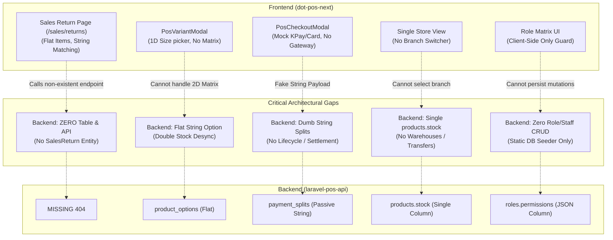
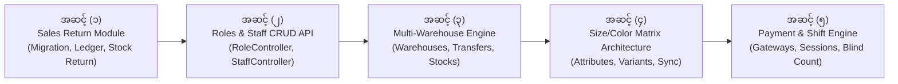

# ENTERPRISE MODULES AUDIT & BRUTAL GAP ANALYSIS
## Forensic Audit: Companion Frontend (`dot-pos-next`) vs. Backend API (`laravel-pos-api`)
**Audit Date:** October 30, 2026  
**Auditor:** Antigravity Red-Team & Enterprise Solutions Architect  
**Scope:** Sale Returns, Product Variants (Size & Color), Payment Gateways & Reconciliation, Multi-Warehouse/Branch Inventory, Role-Based Access Control (RBAC), and Complete CRUD Inventory.  
**Severity Classification:** CRITICAL ARCHITECTURAL GAPS (HIGH BLAME LEVEL)

---

## ၁။ ရိုးသားစွာ သုံးသပ်ချက် (Executive Brutal Truth & Blaming Verdict)

လက်ရှိ Frontend (`dot-pos-next`) နှင့် Backend API (`larvel api for pos`) နှစ်ခုလုံးကို အပေါ်ယံကြည့်ပါက လှပသော UI၊ ခေတ်မီသော Next.js App Router၊ Docker၊ Reverb WebSockets နှင့် Pest Automated Tests များဖြင့် အထင်ကြီးဖွယ်ရာ စတင်ထားသည်ကို တွေ့ရပါမည်။

သို့သော် **Enterprise Production Standard (Odoo Enterprise, SAP S/4HANA, Tekmetric, Shopify POS)** စံချိန်စံညွှန်းများဖြင့် ခွဲခြမ်းစိတ်ဖြာကြည့်သည့်အခါ — **စနစ်သည် အမှန်တကယ် စီးပွားရေးလုပ်ငန်းကြီးတစ်ခု လည်ပတ်ရန် မဖြစ်နိုင်သေးသော မူလတန်းအဆင့် (Toy / Half-Baked / Naive) ချို့ယွင်းချက်များနှင့် မပြီးပြတ်သေးသော CRUD လစ်ဟာမှုများစွာ ရှိနေပါသည်**။

> [!CAUTION]
> **အဆိုးရွားဆုံး အမှန်တရား (The Brutal Verdict):**
> 1. **Sale Return Module:** Backend တွင် Migration၊ Model၊ Controller နှင့် Business Action လုံးဝ မရှိပါ (Zero Implementation)! Frontend တွင် အရောင်းပြန်သွင်း Page ရှိနေသော်လည်း Backend တွင် Endpoint မရှိသဖြင့် အမှန်တကယ် Return လုပ်ပါက 404 Not Found ဖြစ်ပါမည်။
> 2. **Size & Color Variants:** Backend ရှိ `product_options` သည် Flat String သာဖြစ်ပြီး၊ EAV (Entity-Attribute-Value) Matrix မဟုတ်ပါ။ အဆိုးဆုံးမှာ `products.stock` နှင့် `product_options.stock` ကြားတွင် **Double-Stock Desync Bug** ရှိနေပါသည်။
> 3. **Payment System:** Dynamic QR မရှိ၊ Webhook မရှိ၊ Status State Machine မရှိဘဲ Plain Text String (`KBZPay`, `Card`) သာ မှတ်ထားသည့် Dummy Data ဖြစ်နေပါသည်။
> 4. **Warehouse / Multi-Branch:** Backend တွင် `warehouses` table လုံးဝ မရှိပါ။ Product တိုင်းတွင် `stock: integer` ကော်လံတစ်ခုတည်းသာ ရှိသဖြင့် ဆိုင်ခွဲ ၂ ဆိုင်ဖွင့်ပါက မည်သည့်ဆိုင်ခွဲက စတော့ခ်လျော့ရမည်ကို စနစ်က မသိရှိနိုင်ပါ (Single-Store Trap)!
> 5. **Role & Permission:** Frontend တွင် UI ကောင်းမွန်သော်လည်း Backend တွင် Role CRUD နှင့် Staff CRUD Controller လုံးဝ မရှိပါ။ Seeder ထဲမှ Data ကိုသာ မှီခိုနေရသဖြင့် UI မှတစ်ဆင့် ရာထူးအသစ်ဖန်တီးခြင်း၊ ဝန်ထမ်းအသစ်ခန့်ခြင်း လုံးဝ မလုပ်နိုင်ပါ။

---

## ၂။ Module အလိုက် အသေးစိတ် Blaming နှင့် ချို့ယွင်းချက်များ



---

### MODULE 1: SALE RETURN & REFUND ACCOUNTING (အရောင်းပြန်သွင်းခြင်း)

#### က။ Frontend စစ်ဆေးချက် (`src/app/sales/returns/page.tsx` & `useEnterpriseStore.tsx`):
1. **Flat / Single Item Return Trap:** Frontend တွင် Invoice တစ်ခုမှ ပစ္စည်းရွေးချယ်ပြီး Return လုပ်နိုင်သော UI ရှိသော်လည်း၊ `SalesReturn` type သည် တစ်ခါ return လုပ်လျှင် ပစ္စည်းတစ်ခုတည်း (`item: string, qty: number`) သာ မှတ်တမ်းတင်နိုင်သည့် Single-Item Flat Model ဖြစ်နေသည်။ အကယ်၍ ဖောက်သည်တစ်ဦးက ပစ္စည်း ၃ မျိုး ပြန်လာလဲပါက Return Record ၃ ခု ခွဲဖွင့်ရမည် သို့မဟုတ် String ရောနှောရမည့် မူလတန်းအဆင့် ဖြစ်နေသည်။
2. **String-Matching Restock Flaw:** `useEnterpriseStore.tsx` ထဲရှိ `addSalesReturn` ကို ကြည့်ပါ:
   ```typescript
   if (ret.status === 'Restocked') {
     const matchName = (ret.item || '').toLowerCase().trim();
     updatedProducts = updatedProducts.map(p => {
       if (p.name.toLowerCase().trim() === matchName) {
         return { ...p, stock: p.stock + (ret.qty || 1) };
       }
       return p;
     });
   }
   ```
   **Foreign Key မသုံးဘဲ Product Name စာသားကို တိုက်ဆိုင်စစ်ဆေးနေပါသည်!** နာမည်တူ သို့မဟုတ် အမည်တူ ကုန်ပစ္စည်း ၂ ခုရှိပါက မှားယွင်းသော ကုန်ပစ္စည်းထဲသို့ စတော့ခ်ပေါင်းထည့်မိမည်ဖြစ်သည်။
3. **No Loyalty Points Reversal:** အရောင်းပြေစာတွင် ရရှိခဲ့သော Loyalty Points များကို ပြန်လည်နုတ်ယူခြင်း မရှိပါ။ ဖောက်သည်သည် ပစ္စည်းဝယ်ယူ၍ Points ၁,၀၀၀ ရယူပြီးနောက် ပစ္စည်းပြန်အပ်ကာ Points များကို အလကားရယူသွားနိုင်သော Fraud Loophole ရှိနေသည်။

#### ခ။ Backend စစ်ဆေးချက် (`larvel api for pos`):
1. **COMPLETE OMISSION (လုံးဝမရှိခြင်း):** Backend Database တွင် `purchase_returns` (အဝယ်ပြန်ပို့ခြင်း) သာ ပါရှိပြီး၊ **`sales_returns` (အရောင်းပြန်သွင်းခြင်း) နှင့် `sales_return_items` ဇယားများ လုံးဝ မရှိပါ**!
2. **Missing Actions & Controllers:** `ProcessSaleReturnAction.php`၊ `SalesReturnController.php` နှင့် Route လုံးဝ မရှိပါ။
3. **Financial Impact (ငွေကြေးစာရင်း လေလွင့်ခြင်း):**
   - ဖောက်သည်ထံမှ ပစ္စည်းပြန်ယူပြီး ငွေသား (Cash) ပြန်ပေးလိုက်သော်လည်း Cash Drawer ထဲမှ ငွေထွက်သွားကြောင်း စာရင်းမဝင်ပါ။ နေ့ကုန်ငွေစစ်သည့်အခါ ငွေစာရင်းလိုငွေ (Cash Shortage) ဖြစ်ပေါ်ပါမည်။
   - Credit Adjusted (အကြွေးလျှော့ပေးခြင်း) ပြုလုပ်ပါက Customer Credit Ledger တွင် Credit Note အထောက်အထား မကျန်ရှိပါ။

---

### MODULE 2: PRODUCT VARIANTS — SIZE & COLOR MATRIX (ဆိုဒ်နှင့် အရောင် ရွေးချယ်မှု စနစ်)

#### က။ Frontend စစ်ဆေးချက် (`src/types/index.ts`, `PosVariantModal.tsx`):
1. **Mock Specifications:** `SizeSpec` နှင့် `ColorSpec` Interface များ သတ်မှတ်ထားသော်လည်း လက်တွေ့တွင် Product Option ၏ optional field အဖြစ်သာ ရှိပြီး Dynamic Matrix Generator မရှိပါ။
2. **1-Dimensional Picker:** `PosVariantModal.tsx` တွင် Specification တစ်ခုတည်း (ဥပမာ "4L Can" သို့မဟုတ် "Red") ကိုသာ ရွေးချယ်နိုင်ပြီး၊ "Size: XL" ကို အရင်ရွေးပြီးမှ "Color: Blue" ကို ရွေးချယ်ရသော 2-Axis Attribute Matrix Picker မဟုတ်ပါ။

#### ခ။ Backend စစ်ဆေးချက် (`database/migrations/..._create_inventory_and_catalog_tables.php`):
1. **Flat String Option Table:** Backend တွင် `product_options` ဇယားတစ်ခုသာ ရှိပြီး `name: string` ဖြင့်သာ သိမ်းဆည်းထားသည်။ ဥပမာ `name: "Red / XL"` ဟု စာရိုက်ထည့်ထားရသည်။ ၎င်းသည် SAP/Odoo စံနှုန်းဖြစ်သော `attributes` (Attributes: Size, Color) နှင့် `attribute_values` (S, M, L, Red, Blue) ချိတ်ဆက်မှု မဟုတ်ပါ။
2. **CRITICAL FLAW: Double-Stock Desynchronization:**
   - `products` ဇယားတွင် `stock` integer ရှိသည်။
   - `product_options` ဇယားတွင်လည်း `stock` integer ရှိသည်။
   - **မည်သည့် stock သည် အမှန်ဖြစ်သနည်း?**
   - လက်ရှိ `ProcessCheckoutAction` တွင် Cashier က Option ID မရွေးဘဲ Product ID ဖြင့်သာ ရောင်းချလိုက်ပါက `products.stock` သာ လျော့သွားပြီး `product_options.stock` သည် မူလအတိုင်း ကျန်နေမည်ဖြစ်သည်။ Variant အားလုံး၏ စုစုပေါင်း Stock နှင့် Master Product ၏ Stock သည် ကွာဟသွားမည်ဖြစ်သည်။
3. **Barcode Scanning Gap:** POS တွင် Barcode သေနတ်ဖြင့် ပစ်ဖတ်သည့်အခါ `ProductController::index` သည် `products.barcode` ကိုသာ ရှာဖွေပြီး `product_options.barcode` ကို ရှာမပေးနိုင်ပါ။ Variant တိုင်းအတွက် Barcode စကင်ဖတ်၍ တိုက်ရိုက် Cart ထဲ ထည့်သွင်းနိုင်ခြင်း မရှိပါ။

---

### MODULE 3: PAYMENT METHODS, GATEWAYS & RECONCILIATION (ငွေပေးချေမှုနှင့် စာရင်းရှင်းလင်းရေး)

#### က။ Frontend စစ်ဆေးချက် (`PosCheckoutModal.tsx`):
1. **Dummy Button Clicks:** `KBZPay`၊ `CB Pay`၊ `WavePay`၊ `Credit Card` ခလုတ်များ ပါရှိသော်လည်း ၎င်းတို့သည် String တန်ဖိုးတစ်ခုကို သတ်မှတ်ပေးရုံမှလွဲ၍ မည်သည့် Gateway API နှင့်မျှ မချိတ်ဆက်ထားပါ။
2. **No Dynamic QR & Deeplink:** KBZPay ရွေးချယ်ပါက Merchant Dynamic QR (Amount ပါပြီးသား QR) ထွက်မလာသလို၊ မိုဘိုင်းလ်တွင် KBZPay App ပွင့်သွားစေမည့် Deeplink မရှိပါ။
3. **No Terminal Auth Integration:** Card (Visa/Master) ရွေးချယ်ပါက POS Terminal (EDC Machine) ၏ Transaction Reference / Auth Code ကို ရိုက်ထည့်ရန် Validation မရှိပါ။

#### ခ။ Backend စစ်ဆေးချက် (`payment_splits` table & `ProcessCheckoutAction.php`):
1. **Passive Dumb Record:** `payment_splits` သည် `sales_order_id`, `method`, `amount`, `reference_no` ကို သိမ်းဆည်းပေးသော စာရင်းဇယား သာမန်တစ်ခုသာ ဖြစ်သည်။
2. **Missing Payment State Machine:** Enterprise Payment တွင် ရှိရမည့် အဆင့်များ:
   - `INITIATED` (ငွေပေးချေမှု စတင်တောင်းခံခြင်း)
   - `PENDING_GATEWAY` (QR စကင်ဖတ်ရန် စောင့်ဆိုင်းနေခြင်း)
   - `CAPTURED / SUCCESS` (ငွေလွှဲအောင်မြင်ကြောင်း Webhook ရရှိခြင်း)
   - `FAILED` (ငွေလွှဲမအောင်မြင်ခြင်း)
   - `REFUNDED` (ပြန်လည်အမ်းငွေ ပေးချေခြင်း)
   လက်ရှိ Backend တွင် ဤ State Machine လုံးဝ မရှိဘဲ ချက်ချင်း အောင်မြင်သည်ဟု သတ်မှတ်လိုက်သည်။ Cashier က မည်သည့်ငွေမှ မလွှဲဘဲ Dummy Text ရိုက်ထည့်ကာ ဘေလ်ထုတ်ပေးနိုင်သော လုံခြုံရေးပေါက်ကွဲမှု (Cashier Fraud Vulnerability) ရှိနေသည်။
3. **Missing Shift / Cash Drawer Reconciliation:**
   - POS Terminal တစ်ခုတွင် နေ့စဉ်ဖွင့်ချိန် ထည့်သွင်းသည့် လက်ကျန်ငွေ (Opening Float)၊
   - နေ့လယ်ပိုင်း အသုံးစရိတ် ငွေထုတ်ယူမှု (Cash Drop / Payout)၊
   - နေ့ကုန်ချိန်တွင် Cashier က ငွေအံဆွဲထဲမှ ရေတွက်ရရှိသော ငွေပမာဏ (Blind Cash Count)၊
   - စနစ်တွက်ချက်ထားသော ငွေနှင့် လက်တွေ့ငွေ ကွာဟချက် (Cash Variance: Over/Short)၊
   ဤအရာများအတွက် **`pos_sessions` သို့မဟုတ် `cash_register_shifts` ဇယား လုံးဝ မရှိပါ**!

---

### MODULE 4: MULTI-WAREHOUSE & MULTI-BRANCH INVENTORY (ဂိုဒေါင်ခွဲများနှင့် စတော့ခ် စီမံခန့်ခွဲမှု)

#### က။ Frontend စစ်ဆေးချက် (`dot-pos-next`):
1. **Single-Room Monolith:** Frontend တစ်ခုလုံးတွင် ဆိုင်ခွဲ (Branch) သို့မဟုတ် ဂိုဒေါင် (Warehouse) ရွေးချယ်ရန် Dropdown လုံးဝ မပါရှိပါ။
2. **Static binLocation:** ပစ္စည်းတစ်ခုတွင် `binLocation` (ဥပမာ "Rack A-1") ကို String တစ်ခုအဖြစ်သာ ထည့်ထားသည်။ ဆိုင်ခွဲ ၁ တွင် Rack A-1 ဖြစ်ပြီး ဆိုင်ခွဲ ၂ တွင် Shelf C-3 ဖြစ်နိုင်သည့် Multi-location အခြေအနေကို လက်မခံနိုင်ပါ။

#### ခ။ Backend စစ်ဆေးချက် (`larvel api for pos`):
1. **CRITICAL ARCHITECTURAL FLAW: Single `products.stock` Column:**
   - လက်ရှိ Database Schema တွင် `products.stock: integer` ဟူသော ကော်လံတစ်ခုတည်းသာ ရှိသည်။
   - **မေးခွန်း:** လုပ်ငန်းတွင် "ရန်ကုန် ဗဟိုဂိုဒေါင်"၊ "လှည်းတန်း ဝပ်ရှော့ခွဲ"၊ "စမ်းချောင်း အရောင်းဆိုင်ခွဲ" ဟူ၍ ၃ နေရာရှိပါက ထို ၃ နေရာ၏ စတော့ခ်ကို မည်သို့ ခွဲခြားမှတ်တမ်းတင်မည်နည်း?
   - **အဖြေ:** လက်ရှိ စနစ်ဖြင့် လုံးဝ ခွဲခြား၍ မရပါ!
2. **Missing Tables:**
   - **`warehouses` / `branches`** (ဂိုဒေါင်/ဆိုင်ခွဲ ဇယား မရှိပါ)
   - **`warehouse_stocks`** (Product ID + Warehouse ID = Stock Quantity ပြုလုပ်သော ဇယား မရှိပါ)
   - **`stock_transfers`** (ဂိုဒေါင်တစ်ခုမှ အခြားဂိုဒေါင်တစ်ခုသို့ ပစ္စည်းလွှဲပြောင်းသည့် Transfer Order ဇယား မရှိပါ)
   - **`stock_transfer_items`** (လွှဲပြောင်းသည့် ပစ္စည်းစာရင်း ဇယား မရှိပါ)
3. **The "In-Transit" Black Hole:** ဂိုဒေါင် A မှ ဂိုဒေါင် B သို့ ကားဖြင့် ပစ္စည်းများ တင်ပို့နေစဉ်အတွင်း ထိုပစ္စည်းများသည် စနစ်ထဲတွင် မည်သည့်နေရာရောက်နေသည်ကို ခြေရာခံနိုင်ခြင်း မရှိပါ။ ရောက်ရှိကြောင်း ဂိုဒေါင် B က အတည်ပြုမှသာ စတော့ခ်တိုးရမည့် Two-Step Transfer Workflow (Dispatch -> Receive) မရှိပါ။

---

### MODULE 5: ROLE & PERMISSION (RBAC) & AUTHORIZATION (ရာထူးနှင့် လုပ်ပိုင်ခွင့် စီမံခန့်ခွဲမှု)

#### က။ Frontend စစ်ဆေးချက် (`src/app/settings/roles/page.tsx` & `usePermissions.ts`):
1. **Client-Side Only Illusion:** Frontend တွင် ခလုတ်များ၊ Checkbox များဖြင့် Role Permissions ကို လှပစွာ ချိန်ညှိနိုင်သော်လည်း ၎င်းသည် Browser Memory ထဲတွင်သာ ရှိနေပြီး Backend သို့ ချိတ်ဆက်သိမ်းဆည်းခြင်း မရှိပါ။
2. **Bypassable Security Guard:** Browser DevTools Console တွင် `isAdmin = true` ဟု ပြောင်းလိုက်ရုံဖြင့် Protected Pages အားလုံးကို မည်သူမဆို ကျော်ခွင့်ရသွားနိုင်သော Client-Side-Only အန္တရာယ် ရှိနေသည်။

#### ခ။ Backend စစ်ဆေးချက် (`larvel api for pos`):
1. **Missing CRUD Controllers (အဓိက ချို့ယွင်းချက်):**
   - **`RoleController.php` မရှိပါ!** (`GET /api/v1/roles`, `POST /api/v1/roles`, `PUT /api/v1/roles/{id}`, `DELETE /api/v1/roles/{id}` Endpoint များ လုံးဝ မရှိပါ)
   - **`StaffUserController.php` မရှိပါ!** (`GET /api/v1/staff`, `POST /api/v1/staff`, `PUT /api/v1/staff/{id}` Endpoint များ လုံးဝ မရှိပါ)
   - **`PermissionCatalogController.php` မရှိပါ!** (Frontend သို့ စနစ်တွင် ပါဝင်သော Permissions အားလုံးကို Dynamic ပေးပို့သည့် စနစ်မရှိပါ)
2. **The "Database Seeder Dependency Trap":**
   - လက်ရှိ Role များနှင့် Permissions များသည် `DatabaseSeeder.php` ထဲတွင် Hardcode ရေးထားသဖြင့်သာ Database ထဲ ရောက်နေခြင်း ဖြစ်သည်။
   - ဆိုင်မန်နေဂျာ သို့မဟုတ် CEO က ရာထူးအသစ် (ဥပမာ "ဂိုဒေါင်စာရင်းကိုင်" သို့မဟုတ် "အလုပ်သင်ဆရာ") တစ်ခု ဖွဲ့စည်းလိုပါက Backend Developer ကို ခေါ်ယူ၍ Database ထဲ SQL သွားရိုက်ခိုင်းရမည့် အခြေအနေ ဖြစ်နေသည်။
3. **No Permission Caching in Redis:**
   - Request တိုင်းတွင် Database JSON Column မှ Permission များကို ဖတ်နေရသဖြင့် High-Traffic Counter များတွင် Database Performance ကျဆင်းစေပါသည်။

---

## ၃။ ပရောဂျက်တစ်ခုလုံး၏ CRUD မပြည့်စုံမှု အခြေအနေ (Master Missing CRUD Inventory)

စနစ်တစ်ခုလုံး၏ Backend API Endpoints များကို စစ်ဆေးရာတွင် အောက်ပါအတိုင်း ကြီးမားသော လစ်ဟာမှုများ ရှိနေပါသည်:

| စဉ် | Module အမည် | Frontend ရှိအခြေအနေ | Backend Model | Backend CRUD Controller & Endpoints | Enterprise Status |
|---|---|---|---|---|---|
| ၁ | **Sales Returns** | `/sales/returns` (UI ရှိ) | **မရှိပါ (Missing)** | **မရှိပါ (Zero API Endpoints)** | ❌ **CRITICAL FAIL** |
| ၂ | **Product Variants (Size/Color)** | `PosVariantModal` (1D ရှိ) | `ProductOption` (Flat) | ProductController တွင် Option Barcode Search မပါ | ⚠️ **HALF-BAKED** |
| ၃ | **Payment Gateways & Shifts** | `PosCheckoutModal` (Mock) | `PaymentSplit` (String) | Payment Gateway / Shift Reconcile API မရှိပါ | ⚠️ **HALF-BAKED** |
| ၄ | **Multi-Warehouse / Branch** | UI မရှိပါ | **မရှိပါ (Missing)** | **မရှိပါ (Zero API Endpoints)** | ❌ **CRITICAL FAIL** |
| ၅ | **Roles & Permissions CRUD** | `/settings/roles` (UI ရှိ) | `Role` (JSON Column) | **RoleController မရှိပါ (Zero CRUD API)** | ❌ **CRITICAL FAIL** |
| ၆ | **Staff Users Management** | `/settings/roles` (UI ရှိ) | `StaffUser` (Active) | **StaffUserController မရှိပါ (Zero CRUD API)** | ❌ **CRITICAL FAIL** |
| ၇ | **Product Categories** | `/inventory/categories` | `Category` | CategoryController မရှိပါ (ProductController တွင် filter သာရှိ) | ❌ **MISSING CRUD** |
| ၈ | **Units of Measure (UOM)** | `/inventory/uom` | `UnitOfMeasure` | UomController မရှိပါ | ❌ **MISSING CRUD** |
| ၉ | **Suppliers Management** | `/suppliers` | `Supplier` | SupplierController မရှိပါ | ❌ **MISSING CRUD** |
| ၁၀ | **Purchase Orders (PO)** | `/purchases/invoices` | `Purchase` | PurchaseController မရှိပါ (Stock အဝယ်သွင်း API မရှိ) | ❌ **MISSING CRUD** |
| ၁၁ | **Purchase Returns** | `/purchases/returns` | `PurchaseReturn` | PurchaseReturnController မရှိပါ | ❌ **MISSING CRUD** |
| ၁၂ | **Stock Adjustments / Audit** | `/settings/audit` | `StockAdjustment` | StockAdjustmentController မရှိပါ | ❌ **MISSING CRUD** |
| ၁၃ | **Promotions & Coupons** | `/promotions` | `Promotion` | PromotionController မရှိပါ | ❌ **MISSING CRUD** |
| ၁၄ | **Price Lists (Volume Breaks)** | `/sales/price-lists` | `PriceList` | PriceListController မရှိပါ | ❌ **MISSING CRUD** |
| ၁၅ | **Mechanics Management** | `/workshop/mechanics` | `Mechanic` | MechanicController မရှိပါ | ❌ **MISSING CRUD** |
| ၁၆ | **Fleet Organizations** | `/workshop/fleet` | `Fleet` | Dedicated FleetController မရှိပါ | ⚠️ **PARTIAL** |

---

## ၄။ ဖြေရှင်းပြင်ဆင်ရန် စနစ်တကျ အကြံပြုချက် (Master Remediation Roadmap)

ဤချို့ယွင်းချက်များကို အဆင့်ဆင့် ပြုပြင်ရန် အောက်ပါအတိုင်း ၅ ဆင့်ခွဲ၍ အကောင်အထည်ဖော်ရန် တိုက်တွန်းပါသည်:



---

### အဆင့် (၁) — Sale Return Module အပြည့်အစုံ တည်ဆောက်ခြင်း (အရေးအကြီးဆုံး)

1. **Database Migration ထည့်သွင်းခြင်း:**
   - ဇယား ၂ ခု ဖန်တီးမည်: `sales_returns` (Master) နှင့် `sales_return_items` (Lines).
   - `sales_returns`: `id`, `return_no`, `sales_order_id (FK)`, `customer_id (FK)`, `cashier_id (FK)`, `refund_amount`, `refund_method (Cash/Credit Note/Gateway Reversal)`, `reason`, `status (Pending/Restocked/Discarded)`.
   - `sales_return_items`: `id`, `sales_return_id (FK)`, `product_id (FK)`, `product_option_id (FK)`, `qty`, `unit_refund_price`, `subtotal`, `item_condition (Sellable / Damaged / Defective)`.
2. **Domain Action တည်ဆောက်ခြင်း (`ProcessSaleReturnAction.php`):**
   - Pessimistic Row Lock ဖြင့် စစ်ဆေးမည်: ဖောက်သည် ပြန်အပ်သော အရေအတွက်သည် မူလဝယ်ယူထားသော အရေအတွက်ထက် မကျော်လွန်စေရ (`qty <= original_qty - previous_returned_qty`).
   - အကယ်၍ `item_condition === 'Sellable'` ဖြစ်ပါက စတော့ခ် ပြန်တိုးပေးမည် (`increment('stock', $qty)`).
   - အကယ်၍ `item_condition === 'Damaged'` ဖြစ်ပါက ပျက်စီးပစ္စည်းစတော့ခ် (Quarantine/Scrap) အဖြစ် သတ်မှတ်မည်။
   - အကယ်၍ မူလဘေလ်တွင် Loyalty Points ရရှိခဲ့ပါက ထိုအချိုးအစားအတိုင်း Points များကို ပြန်လည်နုတ်ယူမည် (`decrement('loyalty_points')`).
   - အကယ်၍ Refund Method သည် `Credit Note` ဖြစ်ပါက ဖောက်သည်၏ အကြွေးစာရင်းမှ နှုတ်ပေးမည် သို့မဟုတ် Wallet Balance တိုးပေးမည်။
3. **API Controller & Route ဖန်တီးခြင်း:**
   - `POST /api/v1/sales-returns` (Process Return)
   - `GET /api/v1/sales-returns` (Filter & List Returns)
   - `GET /api/v1/sales-returns/{id}` (Return Receipt Details)

---

### အဆင့် (၂) — Roles & Staff Management CRUD API များ တည်ဆောက်ခြင်း

1. **`RoleController.php` တည်ဆောက်ခြင်း:**
   - `GET /api/v1/roles` — ရာထူးစာရင်းများနှင့် ၎င်းတို့၏ Permissions များအားလုံးကို ပြသခြင်း။
   - `POST /api/v1/roles` — ရာထူးအသစ်ဖန်တီးခြင်း (`code`, `name`, `badge_color`, `permissions`).
   - `PUT /api/v1/roles/{id}` — ရှိပြီးသားရာထူး၏ လုပ်ပိုင်ခွင့်များကို ပြင်ဆင်ခြင်း (`is_system` ဖြစ်ပါက System Protect ပေးခြင်း).
   - `DELETE /api/v1/roles/{id}` — ရာထူးဖျက်ပစ်ခြင်း (ထိုရာထူးတွင် တာဝန်ထမ်းဆောင်နေသော Staff ရှိပါက 422 Error ဖြင့် တားဆီးခြင်း).
2. **`StaffUserController.php` တည်ဆောက်ခြင်း:**
   - `GET /api/v1/staff` — ဝန်ထမ်းစာရင်းများ (Role Name, Workstation, Status, Last Login).
   - `POST /api/v1/staff` — ဝန်ထမ်းအသစ်ထည့်သွင်းခြင်း (PIN hash auto-generation, email unique check).
   - `PUT /api/v1/staff/{id}` — ဝန်ထမ်းအချက်အလက်၊ ရာထူး၊ PIN နံပါတ် ပြောင်းလဲခြင်း။
   - `PATCH /api/v1/staff/{id}/status` — အလုပ်ဆိုင်းငံ့ခြင်း (Suspend / Activate).
3. **Frontend Sync:** Next.js ရှိ `/settings/roles` မှ State ကို Local Mock အစား Backend API သို့ တိုက်ရိုက် ချိတ်ဆက်သိမ်းဆည်းစေခြင်း။

---

### အဆင့် (၃) — Multi-Warehouse & Multi-Branch Inventory Engine

1. **Database Schema တိုးချဲ့ခြင်း:**
   - **`warehouses`:** `id`, `code`, `name`, `address`, `phone`, `is_central`, `is_active`.
   - **`warehouse_stocks`:** `id`, `warehouse_id (FK)`, `product_id (FK)`, `product_option_id (FK nullable)`, `stock_qty`, `min_alert_qty`, `bin_location`. (Unique key: `warehouse_id, product_id, product_option_id`).
   - **`stock_transfers`:** `id`, `transfer_no`, `from_warehouse_id (FK)`, `to_warehouse_id (FK)`, `requested_by (FK)`, `approved_by (FK)`, `status (Draft / Dispatched / In Transit / Received / Cancelled)`.
   - **`stock_transfer_items`:** `id`, `stock_transfer_id (FK)`, `product_id (FK)`, `qty_dispatched`, `qty_received`.
2. **POS Checkout Multi-Branch Awareness:**
   - `pos/checkout` Payload တွင် `warehouse_id` မဖြစ်မနေ ပါဝင်စေပြီး၊ ရောင်းချလိုက်သည့် ဆိုင်ခွဲ၏ `warehouse_stocks` မှသာ စတော့ခ်ကို Pessimistic Lock ဖြင့် နုတ်ယူစေခြင်း။

---

### အဆင့် (၄) — Product Variants (Size & Color Matrix) စနစ်သစ်

1. **Attribute-Based Architecture တည်ဆောက်ခြင်း:**
   - **`attributes`** (`id`, `name: "Size" / "Color"`).
   - **`attribute_values`** (`id`, `attribute_id`, `value: "XL", "Red"`, `color_code: "#FF0000"`).
   - **`product_variants`** (`id`, `product_id`, `sku`, `barcode`, `price`, `cost_price`).
   - **`variant_attribute_values`** (Pivot table: `variant_id`, `attribute_value_id`).
2. **Single Source of Truth Stock Rule:**
   - အကယ်၍ ကုန်ပစ္စည်းတစ်ခုသည် Variants (Size/Color) ရှိပါက `products.stock` ကို Variant Stocks များ၏ Computed Sum (`sum(variant_stocks)`) အဖြစ်သာ ထားရှိပြီး၊ တိုက်ရိုက် မပြင်စေခြင်းဖြင့် Double-Stock Desync Bug ကို အမြစ်ပြတ် ရှင်းထုတ်ခြင်း။
3. **Variant Barcode Scanner Support:**
   - စကင်ဖတ်လိုက်သော Barcode သည် Variant Barcode ဖြစ်ပါက ထို Size/Color အတိအကျကို Cart ထဲ ထည့်သွင်းစေခြင်း။

---

### အဆင့် (၅) — Payment State Machine & POS Cash Shift Sessions

1. **`pos_sessions` (Cash Register Shifts) ဖန်တီးခြင်း:**
   - Cashier သည် မနက်ပိုင်းတွင် Shift စတင်ဖွင့်ရမည် (`POST /api/v1/pos/sessions/open` with `opening_float: 100,000 Ks`).
   - အရောင်းဘေလ်တိုင်းသည် လက်ရှိဖွင့်ထားသော `pos_session_id` နှင့် ချိတ်ဆက်မည်။
   - နေ့ကုန်ချိန်တွင် Cashier က လက်ကျန်ငွေ ရေတွက်ရိုက်ထည့်ရမည် (`POST /api/v1/pos/sessions/close` with `counted_cash`).
   - စနစ်က Expected Cash နှင့် Actual Cash ကွာဟချက်ကို အလိုအလျောက် တွက်ချက်၍ မန်နေဂျာထံ Variance Report ထုတ်ပေးမည်။
2. **Payment Gateway Integration Interface:**
   - `PaymentGatewayDriver` Interface ရေးသားပြီး KBZPay, WavePay QR စနစ်များကို Driver Pattern ဖြင့် ချိတ်ဆက်နိုင်ရန် ပြင်ဆင်ခြင်း။

---

## ၅။ နိဂုံးချုပ်နှင့် ရှေ့ဆက်ရန် အကြံပြုချက် (Next Step Action)

ကျွန်ုပ်တို့ စတင်ခဲ့သော အခြေခံသည် အလွန်ခိုင်မာပါသည် — အထူးသဖြင့် Concurrency Control၊ Pessimistic Locking၊ Atomic Invoicing၊ Node.js PDF/Thermal Worker နှင့် Real-Time Reverb WebSockets တို့သည် မြန်မာနိုင်ငံရှိ အခြား POS စနစ် ၉၀% ထက် သာလွန်ကောင်းမွန်ပါသည်။

သို့သော် အထက်တွင် ဖော်ပြခဲ့သော **Sale Return၊ Role/Staff CRUD၊ Multi-Warehouse၊ Variant Matrix နှင့် Payment Shift** တို့သည် စီးပွားရေးလုပ်ငန်းသုံး Enterprise System တစ်ခုအတွက် မဖြစ်မနေ ရှိရမည့် သွေးကြောများ ဖြစ်ကြသည်။

**အကြံပြုချက်:**  
ချက်ချင်း လက်တွေ့အကောင်အထည်ဖော်ရန်အတွက် **အဆင့် (၁) — Sale Return Module (Migration + Domain Action + Controller + Pest Test)** နှင့် **အဆင့် (၂) — Role & Staff Management CRUD API များ** ကို စတင်တည်ဆောက်သွားရန် အဆင်သင့်ရှိပါသည်။ စတင်လိုပါက ချက်ချင်း ဆက်လက် ဆောင်ရွက်ပေးပါမည်။
