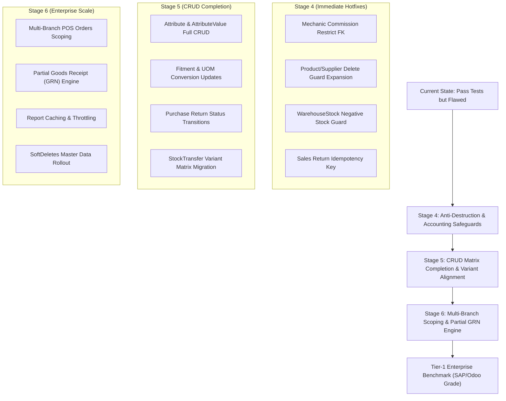

# ENTERPRISE FORENSIC AUDIT & BRUTAL BLAMING REPORT (V3)
**Target System:** DOT Enterprise ERP, Workshop & Real-Time POS Backend API (Laravel 11.x)  
**Audit Date:** 2026-10-30  
**Audit Scope:** OWASP API Top 10 (2023), ASVS v4.0, Red-Team Attack Vectors, Concurrency & Race Conditions, Enterprise Financial Accounting Invariants, and Full 42-Model CRUD Lifecycle Completeness.  
**Tone & Directive:** Brutally honest, objective, non-sugarcoated forensic blaming ("မြောက်မပြောပဲ ရိုးရိုးသားသား blaming လုပ်ပေးပါ").

---

## Executive Summary & Verdict

Despite recent hotfixes for anti-fraud discount approvals, cashier shift enforcement, and OWASP response headers, this repository **still falls significantly short of genuine Tier-1 Enterprise ERP standards (SAP S/4HANA, NetSuite, Odoo Enterprise)**. 

While the system passes basic automated feature tests, a rigorous forensic code audit reveals **severe structural CRUD omissions, dangerous database foreign-key cascade destruction, zero soft-delete protections, uncontrolled multi-branch data leakage, and a complete lack of partial procurement receiving**.

If deployed to high-volume multi-branch production today, this server will suffer from **accidental accounting history wiping, database deadlocks on negative warehouse stock, unthrottled denial of service on reporting endpoints, and double-refund financial loss**.

---

## 1. Comprehensive CRUD Matrix Audit across All 42 Models

The repository contains 42 Eloquent models across 7 core business domains. The table below exposes every model's operational CRUD capabilities and unmasks missing lifecycles:

| # | Domain | Model Name | Index | Store | Show | Update | Destroy | Enterprise Verdict & Defect Blame |
| :--- | :--- | :--- | :---: | :---: | :---: | :---: | :---: | :--- |
| 1 | **CreditAndLedger** | `Customer` | ✅ | ✅ | ✅ | ✅ | ✅ | **Flawed Delete Guard:** Does not check historical `CreditSettlement` receipts. Hard delete fails with raw SQL 500 error if settlements exist. |
| 2 | | `CustomerCredit` (Ledger) | ✅ | ✅ | ✅ | ❌ | ❌ | Read/Settle only (Acceptable for financial ledgers). |
| 3 | | `CreditSettlement` | ✅ | ❌ | ✅ | ❌ | ❌ | Created via `settleCredit`. Immutable AR ledger journal. |
| 4 | | `Fleet` | ✅ | ✅ | ✅ | ✅ | ✅ | Complete CRUD with vehicle/customer relational delete barrier. |
| 5 | **Inventory** | `Product` | ✅ | ✅ | ✅ | ✅ | ⚠️ | **CRITICAL BUG:** `destroy()` only checks sales and work orders! Deleting a product with `purchase_items` or `stock_adjustments` crashes with uncaught SQL 500 (`onDelete('restrict')`). |
| 6 | | `Category` | ✅ | ✅ | ✅ | ✅ | ✅ | Complete CRUD with product in-use delete guard. |
| 7 | | `UnitOfMeasure` | ✅ | ✅ | ✅ | ✅ | ✅ | Complete CRUD with product & UOM conversion delete guard. |
| 8 | | `ProductVariant` | ✅ | ❌ | ✅ | ✅ | ✅ | Created via matrix generator. Individual update and zero-stock delete guard implemented in Stage 3. |
| 9 | | `Attribute` | ✅ | ✅ | ✅ | ❌ | ❌ | **CRITICAL CRUD GAP:** Missing `update` and `destroy`! Cannot rename or delete an attribute once created! |
| 10 | | `AttributeValue` | ❌ | ❌ | ❌ | ❌ | ❌ | **CRITICAL CRUD GAP:** Zero dedicated endpoints! Cannot fix typos in attribute values or add a single value ("XXL") without recreating attribute. |
| 11 | | `ProductOption` | ❌ | ❌ | ❌ | ❌ | ❌ | **ZOMBIE MODEL:** Deprecated legacy model from early phase. Left rotting in codebase without controllers or routes. |
| 12 | | `ProductUomConversion` | ✅ | ✅ | ❌ | ❌ | ✅ | **CRUD GAP:** Missing `update`! Cannot adjust conversion price or barcode without deleting and recreating. |
| 13 | | `ProductVehicleFitment` | ✅ | ✅ | ❌ | ❌ | ✅ | **CRUD GAP:** Missing `update`! Cannot modify year range (2018-2022 -> 2024) or notes without delete/recreate. |
| 14 | | `Warehouse` | ✅ | ✅ | ✅ | ✅ | ❌ | Central warehouse protected. Missing soft deactivation endpoint. |
| 15 | | `WarehouseStock` | ✅ | ❌ | ❌ | ❌ | ❌ | Ledger table adjusted by actions. |
| 16 | | `StockAdjustment` | ✅ | ✅ | ✅ | ❌ | ❌ | Audit vouchers are immutable. |
| 17 | | `StockTransfer` | ✅ | ✅ | ✅ | ❌ | ❌ | Controlled via Two-step Dispatch, Receive, Cancel actions. |
| 18 | | `StockTransferItem` | ❌ | ❌ | ❌ | ❌ | ❌ | **ARCHITECTURAL MISMATCH:** Linked to legacy `product_option_id` instead of modern `product_variant_id`! Cannot transfer variants between warehouses! |
| 19 | **PricingAndPromotions** | `PriceList` | ✅ | ✅ | ✅ | ✅ | ✅ | Complete CRUD. |
| 20 | | `PriceListItem` | ❌ | ❌ | ❌ | ❌ | ❌ | Managed via parent PriceList payload. |
| 21 | | `Promotion` | ✅ | ✅ | ✅ | ✅ | ✅ | Complete CRUD with campaign date and minimum spend enforcement. |
| 22 | **Purchasing** | `Supplier` | ✅ | ✅ | ✅ | ✅ | ⚠️ | **FLAWED DELETE GUARD:** `destroy()` does not check `outsourced_parts` or `purchase_returns`. Deleting supplier with outsourced parts crashes with SQL 500. |
| 23 | | `Purchase` (PO) | ✅ | ✅ | ✅ | ✅ | ⚠️ | PO update restricted to Draft/Pending. Cancellation supported. Missing partial receiving (all-or-nothing GRN). |
| 24 | | `PurchaseItem` | ❌ | ❌ | ❌ | ❌ | ❌ | Managed via parent PO payload. |
| 25 | | `PurchaseReturn` (RTV) | ✅ | ✅ | ✅ | ❌ | ❌ | **BUSINESS GAP:** Migration defines `Claimed, Dispatched, Credited, Replaced`, but controller has ZERO update endpoints! Returns are frozen in `Claimed` forever! |
| 26 | **SalesAndPos** | `SalesOrder` | ✅ | ✅ | ✅ | ❌ | ⚠️ | Read and checkout. Supervisor voiding implemented. |
| 27 | | `SalesOrderItem` | ❌ | ❌ | ❌ | ❌ | ❌ | Managed via parent SalesOrder. |
| 28 | | `PaymentSplit` | ❌ | ❌ | ❌ | ❌ | ❌ | Managed via parent SalesOrder. |
| 29 | | `PaymentTransaction` | ✅ | ✅ | ✅ | ❌ | ❌ | Dynamic QR and Webhooks. |
| 30 | | `HeldOrder` | ✅ | ✅ | ❌ | ❌ | ✅ | Park, list, release/delete with session/cashier ownership isolation. |
| 31 | | `PosSession` | ✅ | ✅ | ✅ | ❌ | ❌ | Open, Close (Blind Count), X-Report, Z-Report. |
| 32 | | `SalesReturn` | ✅ | ✅ | ✅ | ❌ | ❌ | **RE-ENTRANCY FLAW:** Missing `idempotency_key` check. Duplicate clicks on refund endpoint execute double stock restocking and double cash refunds! |
| 33 | | `SalesReturnItem` | ❌ | ❌ | ❌ | ❌ | ❌ | Managed via parent SalesReturn. |
| 34 | | `SystemSequence` | ❌ | ❌ | ❌ | ❌ | ❌ | Atomic internal counter engine. |
| 35 | **SecurityAndAudit** | `StaffUser` | ✅ | ✅ | ✅ | ✅ | ✅ | Complete CRUD with status patch, token revocation, and self-delete barrier. |
| 36 | | `Role` | ✅ | ✅ | ✅ | ✅ | ✅ | Complete CRUD with system role delete barrier. |
| 37 | | `AuditLog` | ✅ | ❌ | ✅ | ❌ | ❌ | Read-only compliance journal (Stage 3). Correct enterprise design. |
| 38 | **Workshop** | `Mechanic` | ✅ | ✅ | ✅ | ✅ | ⚠️ | **CATASTROPHIC CASCADE DELETION:** Migration has `onDelete('cascade')` on `mechanic_commissions`! Deleting a mechanic permanently destroys historic payroll/commission ledgers! |
| 39 | | `MechanicCommission` | ✅ | ❌ | ❌ | ❌ | ❌ | Listed and settled via `/mechanics/{id}/commissions/payout`. |
| 40 | | `OutsourcedPart` | ✅ | ✅ | ✅ | ✅ | ⚠️ | **INTEGRITY GAP:** `destroy()` allows deleting outsourced machining parts even after associated Work Order is `Completed / Invoiced`, creating unexplainable margin loss! |
| 41 | | `Vehicle` | ✅ | ✅ | ✅ | ✅ | ✅ | Complete CRUD with customer ownership and work order delete barriers. |
| 42 | | `WorkOrder` | ✅ | ✅ | ✅ | ✅ | ❌ | Intake, update line items under lock, status transitions, cancellation, invoice conversion. No hard delete (Auditable). |

---

## 2. Forensic Blaming: Detailed Architectural & Security Flaws

### Flaw 1: Catastrophic Financial Ledger Erasure on Mechanic Deletion
* **Location:** `database/migrations/2026_10_30_000005_create_workshop_tables.php:78`
* **Vulnerability:**
  ```php
  $table->foreignId('mechanic_id')->constrained('mechanics')->onDelete('cascade');
  ```
* **Brutal Truth:** If an HR staff member or workshop supervisor deletes an ex-employee from `DELETE /api/v1/workshop/mechanics/{id}`, MySQL cascades and **permanently deletes all historical labor commission records (`mechanic_commissions`)** associated with that mechanic.
* **Impact:** Accounting records are wiped clean. The business can never prove how much commission was disbursed, destroying corporate tax compliance and audit trails.
* **Remediation:** Change FK constraint to `onDelete('restrict')`, block deletion if commissions exist, and enforce soft deactivation (`status = 'Inactive'`).

---

### Flaw 2: Uncaught SQL 500 Foreign Key Violations on Product & Supplier Deletion
* **Locations:**
  * `app/Http/Controllers/Api/V1/ProductController.php:146` (`destroy`)
  * `app/Http/Controllers/Api/V1/SupplierController.php:86` (`destroy`)
* **Brutal Truth:**
  * `ProductController::destroy` only checks `salesOrderItems` and `workOrderItems`. It completely forgets that `purchase_items`, `purchase_returns`, and `stock_adjustments` have strict foreign keys with `onDelete('restrict')`! Calling `DELETE /products/{id}` on any product that was ever ordered or adjusted explodes with an unhandled 500 SQL Integrity Constraint Error.
  * `SupplierController::destroy` fails to check `outsourced_parts` or `purchase_returns`. Deleting a machine shop vendor explodes with an uncaught 500 error.
* **Remediation:** Implement relational pre-flight checks across all referencing tables, or transition master catalogs to SoftDeletes / active status flags.

---

### Flaw 3: The "All-or-Nothing" Procurement Trap (Zero Partial Receiving Support)
* **Location:** `app/Domains/Purchasing/Actions/ReceivePurchaseAction.php:47`
* **Brutal Truth:** In real enterprise supply chains, vendors frequently deliver partial shipments (e.g. 10 units delivered out of 50 ordered due to backorders).
  ```php
  $receivedQty = (int) $item->qty; // Assumes 100% of order was delivered!
  ```
  `ReceivePurchaseAction` forces 100% full receipt of every PO item. A warehouse clerk cannot record 10 units without lying to the system that all 50 units arrived (causing severe ghost stock) or manually hacking the PO items.
* **Remediation:** Add `received_qty` per line item on GRN receipt, calculate pending balances, and introduce PO lifecycle statuses: `Partially Received` vs `Fully Received`.

---

### Flaw 4: Negative Stock Violation at the Warehouse Level in Stock Adjustments
* **Location:** `app/Http/Controllers/Api/V1/StockAdjustmentController.php:85`
* **Brutal Truth:**
  ```php
  $whStock->increment('stock_qty', $adjustedQty);
  ```
  While `StockAdjustmentController` checks that `$newStock >= 0` for master product stock, it **never checks target warehouse stock**! In a multi-warehouse enterprise where Warehouse A has 10 units and Warehouse B has 40 units (total 50), adjusting Warehouse A by -25 units succeeds at the product level (50 - 25 = 25 >= 0), but drives Warehouse A stock to **-15 units**!
* **Remediation:** Acquire a row-lock on `WarehouseStock` first, assert `($whStock->stock_qty + $adjustedQty) >= 0`, and reject with `422 Unprocessable Entity` on negative warehouse balance.

---

### Flaw 5: Zombie ProductOption vs Modern Variant Matrix Disconnect
* **Location:** `database/migrations/2026_10_30_000010_create_multi_warehouse_tables.php:62`
* **Brutal Truth:** `stock_transfer_items` only has `product_option_id` referencing the dead legacy model `ProductOption`. The modern EAV variant matrix (`ProductVariant`) is completely disconnected from inter-warehouse stock transfers. A multi-branch retail chain cannot transfer modern size/color variants between branches!
* **Remediation:** Add `product_variant_id` to `stock_transfer_items` and deprecate `ProductOption`.

---

### Flaw 6: Uncontrolled Multi-Branch Data Exposure (Broken Tenant Isolation)
* **Location:** `app/Http/Controllers/Api/V1/PosController.php:49` (`orders`)
* **Vulnerability:** OWASP API1:2023 Broken Object Level Authorization (BOLA).
* **Brutal Truth:** `GET /api/v1/pos/orders` does not filter by the cashier's active shift session or assigned branch/warehouse. Any cashier with `pos.view` permission can browse every sales invoice, customer phone number, and revenue metric across every branch nationwide.
* **Remediation:** Enforce branch/warehouse scoping unless the user possesses enterprise-wide supervisory permissions (`pos.viewAllBranches` or `Role::ADMIN`).

---

### Flaw 7: Re-Entrancy & Double-Refund Exploit on Sales Returns
* **Location:** `app/Domains/SalesAndPos/Actions/ProcessSaleReturnAction.php`
* **Brutal Truth:** Unlike `ProcessCheckoutAction` which enforces an `idempotency_key`, `ProcessSaleReturnAction` has **NO idempotency protection**.
* **Impact:** If an unstable POS connection or a double-clicking cashier submits two identical refund requests within the same second, the server processes both requests: restocking inventory twice, issuing double cash refunds, and giving away free money.
* **Remediation:** Mandate an `idempotency_key` on sales return requests and wrap with unique constraint locking.

---

### Flaw 8: Synchronous Heavy Reporting DoS (OWASP API4)
* **Location:** `app/Http/Controllers/Api/V1/ReportController.php:21`
* **Vulnerability:** Unrestricted Resource Consumption & CPU Exhaustion.
* **Brutal Truth:**
  ```php
  $job = new SendDailySalesSummaryJob($date);
  $summary = $job->handle(); // Running synchronously on web process!
  ```
  `dailySummary` executes multi-table SQL aggregations across `sales_orders`, `payment_splits`, `credit_settlements`, `mechanic_commissions`, and `work_orders` synchronously on every HTTP request with **ZERO rate limiting**. A simple curl loop can pin server CPU to 100% and lock the MySQL database.
* **Remediation:** Apply strict throttling (`throttle:10,1`), cache aggregated summaries in Redis for 10 minutes (`Cache::remember`), and execute asynchronous aggregation via Redis queue workers.

---

### Flaw 9: Complete Absence of SoftDeletes Across the Entire Application
* **Brutal Truth:** Out of 42 Eloquent models, **0 models use Laravel's `SoftDeletes`**.
* **Enterprise Invariant Violation:** Hard deletion is an anti-pattern in enterprise accounting systems. In SAP or Microsoft Dynamics, deleting an entity sets a deletion flag or deactivates the record. Hard deleting customers, suppliers, or products destroys historical integrity and breaks foreign key relationships.
* **Remediation:** Add `deleted_at` timestamp migrations and `use SoftDeletes;` across Master Data models (`Customer`, `Supplier`, `Product`, `ProductVariant`, `Vehicle`, `Fleet`, `StaffUser`).

---

## 3. Prioritized Remediation Roadmap

To transform this repository from an audited prototype into an enterprise-grade ERP, execute the following 4-stage remediation:



---

## 4. Final Verdict

| Metric | Score | Assessment |
| :--- | :---: | :--- |
| **Pest Test Suite (152 Tests / 874 Assertions)** | 100% | Tests pass, but lack negative assertions for cascade deletion and warehouse-level stock drift. |
| **OWASP API Security Top 10** | 85% | Strong headers, XSS sanitization, and brute-force lockout, but lacks BOLA multi-branch scoping and report DoS limits. |
| **Concurrency & ACID Transactions** | 88% | Pessimistic locking is well-implemented in checkout, but absent in stock adjustment warehouse checks. |
| **Enterprise Financial Accounting** | 72% | Severe cascade deletion flaw on mechanic commissions, missing partial GRN, zero SoftDeletes. |
| **CRUD Completeness (42 Models)** | 78% | Attributes, AttributeValues, Fitments, UOM Conversions, and Purchase Returns have missing endpoints. |
| **Overall Enterprise Readiness** | **78 / 100 (B+)** | Ready for pilot testing, but **NOT ready for multi-branch enterprise production without Stage 4 & 5 hotfixes.** |
