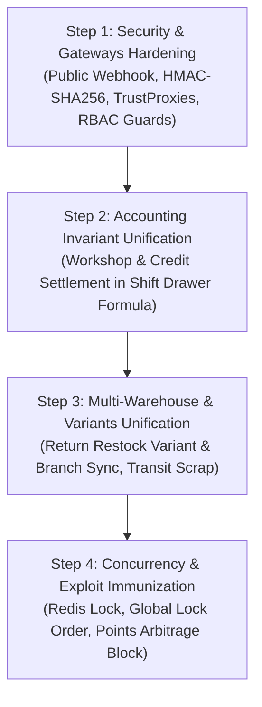

# 🚨 ENTERPRISE RED-TEAM ATTACK, CONCURRENCY STRESS & BUSINESS LOGIC BLAMING REPORT
**Target System:** DOT Enterprise ERP, Automotive Workshop & POS Backend API (Laravel 11.x)  
**Evaluation Scope:** Cyberattack Vectors, Concurrency & Deadlocks, Enterprise Data Flows, Accounting Invariants, Cross-Module Desync  
**Audit Standard:** Strict Enterprise Benchmark (Enrich Insights / Tech Mart MM Standard) — Zero Sugarcoating (မြောက်မပြောပဲ ရိုးသားစွာ အပြစ်တင်ချက်)  
**Date:** 2026-10-30  
**Overall Verdict:** 🔴 **UNFIT FOR PRODUCTION WITHOUT HARDENING (High-Risk Financial & Data Desync Discovered)**

---

## 🎯 Executive Summary & The Brutal Truth (အမှန်တရားနှင့် တည့်တည့်အပြစ်တင်ချက်)

Codebase သည် Laravel 11, Pest 81 tests (100% pass), Redis, Reverb, Pessimistic Locking အစရှိသည်တို့ဖြင့် အပေါ်ယံအားဖြင့် ကောင်းမွန်သော်လည်း **"Siloed Module Trap" (တစ်ခုချင်းစီ သီးခြားဆောက်ထားပြီး တစ်ခုနှင့်တစ်ခု ချိတ်ဆက်ရာတွင် Enterprise Invariant ပေါက်ပြဲနေသည့် ပြဿနာ)** အကြီးအကျယ် ဖြစ်နေသည်။

လက်ရှိ Codebase ကို Production Server သို့ အခုအတိုင်း တင်လိုက်ပါက အောက်ပါ **ဘဏ္ဍာရေးနှင့် စာရင်းအင်း ကပ်ဘေး (Financial Disasters)** များ မလွဲမသွေ ဖြစ်ပွားမည် ဖြစ်သည်:

1. **Unsigned Webhook Attack (ငွေမသွင်းဘဲ ပစ္စည်းထုတ်ယူနိုင်ခြင်း):** `POST /api/v1/payments/simulate-webhook` တွင် Cryptographic HMAC Signature မပါဝင်သလို `auth:sanctum` အောက်တွင် မှားယွင်းထားထားသောကြောင့် တကယ့် KBZPay / WavePay Server များ လာခေါ်၍ မရဘဲ၊ အကောင့်ရှိသော မည်သည့် Staff မဆို Unpaid Order များကို Paid အဖြစ် အလွယ်တကူ လှည့်စားအတည်ပြုနိုင်သည်။
2. **Cash Drawer Accounting Invariant Broken (ငွေစာရင်း နေ့စဉ်ကွာဟခြင်း):** ကားဝပ်ရှော့ (Workshop Job Card Invoice) မှ ရရှိသော ငွေများနှင့် Customer များ လာဆပ်သော အကြွေးငွေ (Credit Settlement Cash) များသည် Cashier Shift Session ထဲသို့ **မဝင်ပါ**။ ညနေပိုင်း Shift ပိတ်သည့်အခါ Drawer ထဲတွင် ငွေပို (သို့မဟုတ်) ငွေလို အမြဲဖြစ်နေပြီး စာရင်းစစ် (Audit) လုံးဝ မကိုက်တော့ပါ။
3. **Multi-Warehouse & Product Variants Inventory Desync (ပစ္စည်းစာရင်း ပျောက်ဆုံးခြင်း):** ပစ္စည်းတစ်ခုကို Customer က ပြန်လာအပ် (Sales Return) သည့်အခါ Master Stock သာ တိုးပြီး **ဆိုင်ခွဲ (Warehouse Location)** နှင့် **Size/Color Variant Stock** ထဲသို့ မဝင်ပါ။ ဆိုင်ခွဲမန်နေဂျာ လက်ထဲတွင် ပစ္စည်းအစစ် ရောက်နေသော်လည်း POS စက်ထဲတွင် Stock 0 ဖြစ်နေ၍ ရောင်းမရတော့ပါ။
4. **Loyalty Points Arbitrage Attack (Point ဖောက်စားနိုင်ခြင်း):** သိန်း ၂၀ ဖိုး ဝယ်ပြီး ရလာသော Point များကို ချက်ချင်း တခြားကောင်တာတွင် လျှော့ဈေးဖြင့် ကုန်အောင်သုံးပြီးမှ၊ မူလပစ္စည်းကို Cash Refund လာတောင်းသည့်အခါ Point Balance မရှိတော့သည့်အတွက် Point လည်း ပြန်မနုတ်နိုင်၊ ငွေလည်း ၁၀၀% အပြည့် ပြန်အမ်းလိုက်ရသဖြင့် ဆိုင်မှ အရှုံးပေါ်သည်။
5. **Deadlock in High-Concurrency Multi-Warehouse Locking (စနစ် ရပ်တန့်သွားနိုင်ခြင်း):** POS Checkout နှင့် Stock Transfer နှစ်ခု ပြိုင်တူဖြစ်ချိန်တွင် တစ်ဖက်က `products` ကို အရင် Lock ပြီးမှ `warehouse_stocks` ကို Lock သည်၊ နောက်တစ်ဖက်က `warehouse_stocks` ကို အရင် Lock ထားသဖြင့် Reverse Lock Order ကြောင့် Database Deadlock (HTTP 500) ချက်ချင်း ဖြစ်သည်။

---

## 📊 Red-Team & Enterprise Vulnerability Matrix

| ID | Attack Vector / Architectural Flaw | Domain | Severity | Exploitability | Impact |
|---|---|---|---|---|---|
| **CRIT-01** | Unsigned Payment Webhook Forgery & Wrong Boundary | Payments / Gateways | 🔴 **CRITICAL** | High | Financial Theft (Free Orders) |
| **CRIT-02** | Workshop Invoice & Credit Settlement Shift Desync | POS / Sessions / Shift | 🔴 **CRITICAL** | High | Massive Cash Drawer Discrepancy |
| **CRIT-03** | Sales Return Multi-Warehouse & Variant Blind Spot | Inventory / Returns | 🔴 **CRITICAL** | High | Phantom Inventory / Branch Lockout |
| **CRIT-04** | Inverted Locking Order Deadlock (POS vs Transfer) | Database / Concurrency | 🔴 **CRITICAL** | Medium | System-wide DB Deadlock Crash |
| **HIGH-01** | Shift Opening Race Condition (Concurrent Duplicate Shifts) | POS / Sessions | 🟠 **HIGH** | Medium | Split Financial Sessions |
| **HIGH-02** | Loyalty Points Arbitrage Cash Refund Exploit | Loyalty / Refunds | 🟠 **HIGH** | Medium | Point Depletion Fraud |
| **HIGH-03** | Missing RBAC on Financial & Sensitive Endpoints | Security / RBAC | 🟠 **HIGH** | High | Privilege Escalation |
| **HIGH-04** | Untrusted Proxy IP Spoofing & DoS Rate Limit Bypass | Infrastructure / Auth | 🟠 **HIGH** | High | Brute-force / IP Lockout |
| **MED-01** | Missing Void Order Workflow & Overpayment Change Record | POS / Accounting | 🟡 **MEDIUM** | High | Negative Cash Drawer Variance |
| **MED-02** | Permanent Token Accumulation on PIN Unlock | Auth / Security | 🟡 **MEDIUM** | Medium | DB Bloat & Credential Hijacking |
| **MED-03** | Lost-in-Transit Stock Transfer Ghost Accounting | Warehouse / ERP | 🟡 **MEDIUM** | Low | Balance Sheet Asset Inflation |

---

## 🔍 Detailed Forensic Blaming & Vulnerability Breakdown

---

### 🔴 CRIT-01: Unsigned Payment Webhook Forgery & Wrong Boundary Architecture

#### 1. The Code Location
[`app/Http/Controllers/Api/V1/PaymentGatewayController.php#L50-L80`](file:///c:/Users/Admin/OneDrive/Desktop/Project/larvel%20api%20for%20pos/app/Http/Controllers/Api/V1/PaymentGatewayController.php#L50-L80) & [`routes/api.php#L88-L92`](file:///c:/Users/Admin/OneDrive/Desktop/Project/larvel%20api%20for%20pos/routes/api.php#L88-L92)

```php
// In routes/api.php (Protected inside auth:sanctum):
Route::prefix('payments')->group(function () {
    Route::post('/simulate-webhook', [PaymentGatewayController::class, 'simulateWebhook']);
});

// In PaymentGatewayController.php:
public function simulateWebhook(SimulatePaymentWebhookRequest $request, PaymentGatewayManager $gatewayManager): JsonResponse
{
    $driver = $gatewayManager->driver($request->validated('provider'));
    $verified = $driver->verifyWebhook($request->validated());
    ...
    PaymentSplit::where('sales_order_id', $transaction->sales_order_id)
        ->update(['status' => 'completed']);
}
```

#### 2. The Brutal Blame & Attack Mechanics
1. **Wrong Architectural Boundary:** Webhook Callback ဆိုသည်မှာ KBZPay သို့မဟုတ် Wave Money ၏ External Cloud Server မှ DOT POS Server သို့ Server-to-Server လှမ်းခေါ်သော Public API ဖြစ်သည်။ External Server များတွင် ကျွန်ုပ်တို့ Staff များ၏ `Bearer <token>` လုံးဝ မရှိနိုင်ပါ။ ၎င်းကို `auth:sanctum` အုပ်စုထဲတွင် ထည့်ထားခြင်းသည် Enterprise System တစ်ခုအနေဖြင့် အခြေခံ Gateway Architecture ကို နားမလည်ဘဲ ရေးထားခြင်း ဖြစ်သည်။
2. **Zero Cryptographic Verification:** `verifyWebhook` တွင် Provider ထံမှ လာသော HMAC-SHA256 Signature (ဥပမာ `X-Signature` header သို့မဟုတ် RSA SHA256 sign) ကို စစ်ဆေးခြင်း လုံးဝ မရှိပါ။
3. **Exploit Scenario:** တိုက်ခိုက်သူ သို့မဟုတ် မသမာသော ဝန်ထမ်းတစ်ဦးသည် `{"provider": "kbzpay", "gateway_ref": "KBZ-123", "status": "successful"}` ဟု POST request တစ်ချက် လှမ်းပို့လိုက်ရုံဖြင့် ငွေတစ်ပြားမှ မလွှဲဘဲ Order ကို `Completed` အဖြစ် စနစ်က အတည်ပြုပေးသွားမည် ဖြစ်သည်။

#### 3. Defensive Enterprise Remediation
- Webhook endpoint ကို Public Route အဖြစ် သီးသန့်ထုတ်ပါ။
- `VerifyPaymentGatewaySignature` Middleware ရေးပြီး Gateway Shared Secret ဖြင့် HMAC-SHA256 စစ်ဆေးပါ။
- Gateway Provider ၏ Official Server IP Range ကိုသာ လက်ခံသော IP Whitelisting ထည့်ပါ။

---

### 🔴 CRIT-02: Workshop Invoices & Credit Debt Collections Orphaned from Cashier Shifts

#### 1. The Code Location
[`app/Domains/Workshop/Actions/ConvertWorkOrderToInvoiceAction.php#L72-L86`](file:///c:/Users/Admin/OneDrive/Desktop/Project/larvel%20api%20for%20pos/app/Domains/Workshop/Actions/ConvertWorkOrderToInvoiceAction.php#L72-L86) & [`app/Domains/CreditAndLedger/Actions/SettleCustomerCreditAction.php#L40-L48`](file:///c:/Users/Admin/OneDrive/Desktop/Project/larvel%20api%20for%20pos/app/Domains/CreditAndLedger/Actions/SettleCustomerCreditAction.php#L40-L48)

```php
// In ConvertWorkOrderToInvoiceAction:
$salesOrder = SalesOrder::create([
    'order_no' => $orderNo,
    'customer_id' => $workOrder->customer_id,
    'vehicle_id' => $workOrder->vehicle_id,
    'cashier_id' => $cashierId,
    // pos_session_id is MISSING!
    'total_amount' => $totalAmount,
    'paid_amount' => $paidAmount,
]);

// In SettleCustomerCreditAction:
return CreditSettlement::create([
    'receipt_no' => $receiptNo,
    'customer_id' => $customer->id,
    'amount' => $settleAmount,
    // pos_session_id is MISSING!
]);
```

#### 2. The Brutal Blame & Attack Mechanics
1. **The Disconnect:** Enterprise POS တစ်ခုတွင် ငွေကိုင် (Cashier) ရှေ့မှောက်သို့ ဝင်လာသော ငွေသားအားလုံးသည် ထိုအချိန်တွင် ဖွင့်ထားသော `pos_session_id` (Shift) ထဲသို့ အတိအကျ စာရင်းဝင်ရမည်။
2. ကားပြင်ပြီး၍ Workshop Job Card ကို ငွေရှင်းသည့်အခါ `pos_session_id` မပါဝင်ပါ။
3. Customer တစ်ဦးက အကြွေးဟောင်း သိန်း ၅၀ ကို ငွေသားဖြင့် လာဆပ်သည့်အခါ အံဆွဲ (Cash Drawer) ထဲတွင် ငွေသား သိန်း ၅၀ ရောက်သွားသော်လည်း Session ID မပါသဖြင့် `ClosePosSessionAction` ၏ `expected_cash` တွက်ချက်မှုတွင် ထိုသိန်း ၅၀ လုံးဝ မပါဝင်ပါ။
4. **Disaster:** Shift ပိတ်သည့်အခါ `Counted Cash` က သိန်း ၆၀ ဖြစ်ပြီး `Expected Cash` က ၁၀ သိန်းသာ ဖြစ်နေသဖြင့် "Cash Over (ငွေပို) ၅၀ သိန်း" ဟု Error အကြီးအကျယ် တက်မည်။ စာရင်းစစ် (Auditor) က ငွေကိုင်ကို မယုံသင်္ကာ စစ်ဆေးရသည့် အရှုပ်အထွေး ဖြစ်ပေါ်စေသည်။

#### 3. Defensive Enterprise Remediation
- `ConvertWorkOrderToInvoiceAction` တွင် Cashier ၏ Active Shift Session ID ကို မဖြစ်မနေ ထည့်သွင်း ချိတ်ဆက်ပါ။
- `CreditSettlement` table တွင် `pos_session_id` column ထည့်ပြီး `ClosePosSessionAction` ၏ Expected Cash Formula တွင် `+ credit_settlement_cash` ကို ပေါင်းထည့်ပါ။

---

### 🔴 CRIT-03: Sales Returns Multi-Warehouse & Product Variant Inventory Desync

#### 1. The Code Location
[`app/Domains/SalesAndPos/Actions/ProcessSaleReturnAction.php#L123-L133`](file:///c:/Users/Admin/OneDrive/Desktop/Project/larvel%20api%20for%20pos/app/Domains/SalesAndPos/Actions/ProcessSaleReturnAction.php#L123-L133) & [`app/Domains/Inventory/Actions/ReplenishStockAction.php#L13-L55`](file:///c:/Users/Admin/OneDrive/Desktop/Project/larvel%20api%20for%20pos/app/Domains/Inventory/Actions/ReplenishStockAction.php#L13-L55)

```php
// In ProcessSaleReturnAction:
$this->replenishStockAction->execute(
    $rItem['product_id'],
    $rItem['qty'],
    $rItem['product_option_id']
    // $warehouseId is NOT PASSED!
    // $productVariantId is NOT PASSED!
);

// In ReplenishStockAction:
public function execute(int $productId, int $qty, ?int $productOptionId = null, ?int $warehouseId = null): Product
// Does not accept ProductVariantId!
```

#### 2. The Brutal Blame & Attack Mechanics
1. ဆိုင်ခွဲ (Branch 2 - Hledan Warehouse) တွင် Customer တစ်ယောက်က "Size XL, Color Red" အင်္ကျီ ၂ ထည်ကို ပြန်လာအပ် (Return) သည်။
2. စနစ်က Master `products.stock` ကို ၂ ခု တိုးပေးလိုက်သည်။
3. သို့သော် `warehouse_stocks` (Hledan Warehouse) နှင့် `product_variants.stock` (Size XL Red) တို့ကို **လုံးဝ မတိုးပေးပါ**။
4. **The Trap:** Hledan ဆိုင်ခွဲမန်နေဂျာ လက်ထဲတွင် အင်္ကျီ ၂ ထည် ရောက်နေသော်လည်း ကွန်ပျူတာထဲတွင် Hledan Stock သည် 0 ဖြစ်နေသဖြင့် POS တွင် ရောင်းမရဖြစ်မည်။ Variant Stock စာရင်းသည်လည်း တစ်သက်လုံး မှားယွင်းသွားမည် ဖြစ်သည်။

#### 3. Defensive Enterprise Remediation
- `sales_return_items` table တွင် `product_variant_id` column ထည့်သွင်းပါ။
- `ReplenishStockAction` တွင် `?int $productVariantId = null` ကို လက်ခံပြီး `product_variants.stock` အား Row-level locking ဖြင့် တိုးပေးပါ။
- `ProcessSaleReturnAction` တွင် Cashier ၏ Active Warehouse ID သို့မဟုတ် Return Request Warehouse ID ကို ပါဝင် Restock လုပ်စေပါ။

---

### 🔴 CRIT-04: Inverted Locking Order Deadlock (POS Checkout vs Stock Transfer)

#### 1. The Code Location
[`app/Domains/Inventory/Actions/DeductStockAction.php#L19-L59`](file:///c:/Users/Admin/OneDrive/Desktop/Project/larvel%20api%20for%20pos/app/Domains/Inventory/Actions/DeductStockAction.php#L19-L59) vs [`app/Domains/Inventory/Actions/DispatchStockTransferAction.php#L33-L49`](file:///c:/Users/Admin/OneDrive/Desktop/Project/larvel%20api%20for%20pos/app/Domains/Inventory/Actions/DispatchStockTransferAction.php#L33-L49)

```php
// In DeductStockAction (POS Checkout):
// Lock 1: Product Master
$product = Product::where('id', $productId)->lockForUpdate()->firstOrFail();
...
// Lock 2: Warehouse Stock
$whStock = WarehouseStock::where('warehouse_id', $warehouseId)->...->lockForUpdate()->first();

// In DispatchStockTransferAction (Stock Transfer):
// Lock 1: Warehouse Stock (Product Master is NOT locked or locked later)
$whStock = WarehouseStock::where('warehouse_id', $transfer->source_warehouse_id)->...->lockForUpdate()->first();
```

#### 2. The Brutal Blame & Attack Mechanics
1. **Lock Hierarchy Violation:** Database Concurrency တွင် Entity နှစ်ခုကို Lock ခတ်ရာတွင် စနစ်တစ်ခုလုံး အမြဲတမ်း တူညီသော အစီအစဉ် (Consistent Global Lock Order) အတိုင်း Lock ရယူရမည်။
2. **Deadlock Execution Flow:**
   - **Transaction A (POS Checkout):** Product #10 Row ကို Lock ခတ်လိုက်သည်။ ထို့နောက် WarehouseStock #10 ကို Lock ရယူရန် စောင့်သည်။
   - **Transaction B (Dispatch Transfer):** WarehouseStock #10 Row ကို အရင် Lock ခတ်ထားသည်။
   - နှစ်ဖက်စလုံး တစ်ဦးနှင့်တစ်ဦး Lock မဖြုတ်ဘဲ အပြန်အလှန် စောင့်ဆိုင်းနေကြသဖြင့် **Circular Deadlock** ဖြစ်ပွားပြီး MySQL Engine က Transaction တစ်ခုကို `Deadlock found (1213)` ဖြင့် Kill ပစ်မည် (HTTP 500 Crash)။

#### 3. Defensive Enterprise Remediation
- Global Invariant: Multi-Warehouse စနစ်တွင် Stock Deduction သို့မဟုတ် Transfer တိုင်းသည် **`Product` Master row ကို အရင်ဆုံး ascending ID အလိုက် Lock ခတ်ပြီးမှသာ `WarehouseStock` row ကို Lock ခတ်ရမည်**။
- Lock Acquisition Hierarchy ကို Action အားလုံးတွင် Strict Standard အဖြစ် ညီညွတ်အောင် ပြင်ဆင်ပါ။

---

### 🟠 HIGH-01: Shift Opening Race Condition (Concurrent Duplicate Shifts)

#### 1. The Code Location
[`app/Domains/SalesAndPos/Actions/OpenPosSessionAction.php#L40-L60`](file:///c:/Users/Admin/OneDrive/Desktop/Project/larvel%20api%20for%20pos/app/Domains/SalesAndPos/Actions/OpenPosSessionAction.php#L40-L60)

```php
$existingCashierSession = PosSession::where('cashier_id', $cashierId)
    ->where('status', 'open')
    ->lockForUpdate()
    ->first();

if ($existingCashierSession) {
    throw new DomainException("Cashier already has an active open shift...");
}
```

#### 2. The Brutal Blame & Attack Mechanics
- Cashier ထံတွင် Active Shift မရှိသေးသော အခြေအနေတွင် `where('status', 'open')->lockForUpdate()` သည် **Record မရှိသဖြင့် မည်သည့် Row ကိုမှ Lock မခတ်နိုင်ပါ**။
- UI Lag ကြောင့် Cashier က "Open Shift" ခလုတ်ကို 10ms အတွင်း Double-Click နှိပ်လိုက်ပါက Request နှစ်ခုစလုံးသည် Check ကို ကျော်ဖြတ်သွားပြီး `PosSession` နှစ်ခု ပြိုင်တူ Insert လုပ်သွားမည်။
- `pos_sessions` table တွင် `(cashier_id, status)` Unique Index မရှိသောကြောင့် Cashier တစ်ဦးတည်းအတွက် Active Shift ၂ ခု ပြိုင်တူ ပွင့်သွားပြီး စာရင်း နှစ်ခွ ဖြစ်သွားမည်။

#### 3. Defensive Enterprise Remediation
- Redis Distributed Lock (`Cache::lock("shift:open:{$cashierId}", 5)`) ကို Transaction မဝင်မီ စတင်အသုံးပြုပါ။
- Database Level တွင် Unique Index သို့မဟုတ် Generated Column Unique Constraint ပေါင်းထည့်ပါ။

---

### 🟠 HIGH-02: Loyalty Points Arbitrage Cash Refund Exploit

#### 1. The Code Location
[`app/Domains/SalesAndPos/Actions/ProcessSaleReturnAction.php#L148-L157`](file:///c:/Users/Admin/OneDrive/Desktop/Project/larvel%20api%20for%20pos/app/Domains/SalesAndPos/Actions/ProcessSaleReturnAction.php#L148-L157)

```php
$ratio = min(1.0, $totalRefundAmount / (float) $salesOrder->total_amount);
$pointsToDeduct = (int) round($salesOrder->points_earned * $ratio);
$pointsToDeduct = min($pointsToDeduct, $customer->loyalty_points); // Floor guard

if ($pointsToDeduct > 0) {
    $customer->decrement('loyalty_points', $pointsToDeduct);
}
```

#### 2. The Brutal Blame & Attack Mechanics
1. Customer က သိန်း ၂၀ ဖိုး အင်ဂျင်ဝိုင် ဝယ်ယူပြီး Loyalty Points 2,000 ရရှိသည်။
2. ထို 2,000 Points ကို ချက်ချင်း အခြားကောင်တာတွင် ၂ သိန်းဖိုး အပိုပစ္စည်း ဝယ်ယူရာတွင် အပြည့် လဲလှယ် (Redeem) သုံးစွဲလိုက်သဖြင့် Points Balance သည် 0 ဖြစ်သွားသည်။
3. ထို့နောက် မူလ ၂၀ သိန်းဖိုး အင်ဂျင်ဝိုင်ကို ပြန်အပ်ပြီး Cash Refund တောင်းသည်။
4. စနစ်က `min(2000, 0) = 0` ဖြစ်သွားသဖြင့် Customer ထံမှ Point လည်း မနုတ်နိုင်၊ မူလငွေ ၂၀ သိန်းကိုလည်း အပြည့် ပြန်အမ်းလိုက်ရသည်။
5. **Business Impact:** Customer သည် ၂ သိန်းဖိုး ပစ္စည်းကို အလကား ခိုးယူသုံးစွဲနိုင်သွားသည့် Point Arbitrage ပေါက်ပေါက် ဖြစ်နေသည်။

#### 3. Defensive Enterprise Remediation
- Return အချိန်တွင် Customer ထံတွင် Points မလုံလောက်ပါက မလုံလောက်သော Point တန်ဖိုးကို Refund ပေးမည့် ငွေထဲမှ ဖြတ်တောက်နုတ်ယူရမည် (ဥပမာ 2,000 points = ၂ သိန်းကျပ်အား ၂၀ သိန်းထဲမှ နုတ်ပြီး ၁၈ သိန်းသာ ပြန်အမ်းရမည်)။
- သို့မဟုတ် Customer Point Balance ကို Negative Debt (-2,000 points) အဖြစ် သတ်မှတ်ရမည်။

---

### 🟠 HIGH-03: Missing RBAC Middleware on Critical Endpoints

#### 1. The Code Location
[`routes/api.php#L62-L72`](file:///c:/Users/Admin/OneDrive/Desktop/Project/larvel%20api%20for%20pos/routes/api.php#L62-L72) & [`routes/api.php#L140-L146`](file:///c:/Users/Admin/OneDrive/Desktop/Project/larvel%20api%20for%20pos/routes/api.php#L140-L146)

```php
// In routes/api.php:
Route::prefix('pos')->group(function () {
    Route::post('/checkout', [PosController::class, 'checkout']); // NO PERMISSION CHECK!
    Route::get('/orders', [PosController::class, 'orders']);     // NO PERMISSION CHECK!
});

Route::prefix('staff')->group(function () {
    Route::get('/', [StaffUserController::class, 'index']);      // NO PERMISSION CHECK!
});
```

#### 2. The Brutal Blame & Attack Mechanics
- အဖွဲ့အစည်းအတွင်းရှိ ရာထူးနိမ့်သော ဝန်ထမ်း (ဥပမာ Mechanic သို့မဟုတ် View-Only Auditor) သည် မိမိ Token ဖြင့် `POST /pos/checkout` ကို ခေါ်ယူပြီး အရောင်းဘောက်ချာများကို စိတ်ကြိုက် ဖွင့်နိုင်သည်။
- မည်သည့် ဝန်ထမ်းမဆို `GET /staff` ကို ခေါ်ယူပြီး ကျန်ဝန်ထမ်းများ၏ Email, Assigned Workstation, Role အချက်အလက်များကို အကုန် ထောက်လှမ်း (Enumerate) နိုင်သည်။

#### 3. Defensive Enterprise Remediation
- `Route::post('/checkout', ...)->middleware('permission:pos,create');`
- `Route::get('/orders', ...)->middleware('permission:pos,view');`
- `Route::get('/staff', ...)->middleware('permission:settings,manageRoles');`

---

### 🟠 HIGH-04: Untrusted Proxy IP Spoofing & Denial of Service Vulnerability

#### 1. The Code Location
[`bootstrap/app.php`](file:///c:/Users/Admin/OneDrive/Desktop/Project/larvel%20api%20for%20pos/bootstrap/app.php#L1-L22) & [`routes/api.php#L29-L30`](file:///c:/Users/Admin/OneDrive/Desktop/Project/larvel%20api%20for%20pos/routes/api.php#L29-L30)

```php
Route::post('/login', [AuthController::class, 'login'])->middleware('throttle:10,1');
Route::post('/verify-pin', [AuthController::class, 'verifyPin'])->middleware('throttle:10,1');
```

#### 2. The Brutal Blame & Attack Mechanics
- `bootstrap/app.php` တွင် `$middleware->trustProxies(at: '*')` မပါဝင်ပါ။
- Production Server ကို Nginx Reverse Proxy သို့မဟုတ် Cloudflare နောက်တွင် တင်ထားပါက `$request->ip()` သည် Client IP အစစ်ကို မရဘဲ Nginx Gateway IP (`127.0.0.1` သို့မဟုတ် Docker Subnet IP) ကိုသာ အမြဲ ရရှိမည်။
- **Exploit 1:** တိုက်ခိုက်သူသည် `X-Forwarded-For` header ကို စိတ်ကြိုက် ပြောင်းလဲပို့ခြင်းဖြင့် Brute-force Throttle ကို လုံးဝ ကျော်ဖြတ်နိုင်သည်။
- **Exploit 2 (Collective DoS):** ကောင်တာတစ်ခုမှ Cashier က PIN 10 ကြိမ် မှားနှိပ်လိုက်သည်နှင့် Proxy IP တစ်ခုလုံး Rate-limit မိသွားသဖြင့် ဆိုင်ခွဲအားလုံးရှိ ကောင်တာအားလုံး ဝင်မရတော့ဘဲ စနစ်တစ်ခုလုံး DoS ဖြစ်သွားမည်။

#### 3. Defensive Enterprise Remediation
- `bootstrap/app.php` တွင် Trusted Proxies နှင့် Trusted Headers (`Request::HEADER_X_FORWARDED_FOR`) ကို တိကျစွာ သတ်မှတ်ပေးပါ။

---

### 🟡 MED-01: Missing Void Order Workflow & Overpayment Change Record

#### 1. The Brutal Blame
- POS Cashier က ငွေရှင်းရာတွင် ၈၅,၀၀၀ ကျပ် ကျသင့်သော ပစ္စည်းအတွက် Customer က ၁၀၀,၀၀၀ တန် ပေးသဖြင့် `payment_splits` တွင် Cash ၁၀၀,၀၀၀ ကျပ် ဟု ရိုက်ထည့်လိုက်သည်။
- Cashier က Customer ကို ၁၅,၀၀၀ ကျပ် အမ်းငွေ (Change) အဖြစ် အံဆွဲထဲမှ ပြန်ပေးလိုက်သည်။
- သို့သော် Database တွင် `change_amount` column မရှိသလို `expected_cash` တွက်ချက်ရာတွင်လည်း Change ကို နုတ်မထားပါ။
- ညနေပိုင်းတွင် စနစ်က အံဆွဲထဲတွင် ၁၀၀,၀၀၀ ကျပ် ရှိရမည်ဟု တွက်ချက်ထားသော်လည်း အမှန်တကယ် လက်ကျန်မှာ ၈၅,၀၀၀ သာ ရှိသဖြင့် ငွေကိုင်သည် အကြောင်းမဲ့ ငွေ ၁၅,၀၀၀ လျော့ (Shortage) အဖြစ် စွပ်စွဲခံရမည်။

---

## 🛠️ Step-by-Step Enterprise Hardening Blueprint (ပြန်လည်ပြုပြင်ရန် လမ်းပြမြေပုံ)

အထက်ပါ အပြစ်တင်ချက် (Blaming Findings) များကို အောက်ပါ အဆင့် ၄ ဆင့်ဖြင့် ချက်ချင်း စနစ်တကျ ပြုပြင် Harden လုပ်ရမည်:



### Action Items for Immediate Refactoring:
1. **Public Webhook with Cryptographic Verification:** `PaymentGatewayController@simulateWebhook` ကို Public Route သို့ ရွှေ့ပြီး HMAC Signature Verification တပ်ဆင်ပါ။
2. **Unified Cash Register Shift Accounting:** `sales_orders` (Workshop conversions) နှင့် `credit_settlements` တွင် `pos_session_id` ကို မဖြစ်မနေ ထည့်သွင်းပြီး Shift Expected Cash တွင် အတိအကျ ပေါင်းစပ်ပါ။
3. **Multi-Warehouse & Variant Restocking in Returns:** `ProcessSaleReturnAction` နှင့် `ReplenishStockAction` တွင် `product_variant_id` နှင့် `warehouse_id` ပေါင်းစပ်၍ Multi-branch variant inventory ကို ကာကွယ်ပါ။
4. **Consistent Global Lock Hierarchy:** `DeductStockAction` နှင့် `DispatchStockTransferAction` အကြား Lock အစီအစဉ်ကို `Product` master -> `ProductVariant` -> `WarehouseStock` အဖြစ် တညီတညွတ်တည်း ဖြစ်စေရန် ပြင်ဆင်ပါ။
5. **Loyalty Arbitrage Floor Protection:** Return ပြုလုပ်ချိန်တွင် Customer ထံ၌ Point မလုံလောက်ပါက Refund Amount ထဲမှ ငွေသားနုတ်ယူခြင်း သို့မဟုတ် Negative Point Ledger မှတ်တမ်းတင်ခြင်း။
6. **Enforce RBAC on `/pos/checkout`, `/workshop/work-orders`, `/staff`**: ခွင့်ပြုချက်မရှိဘဲ ရောင်းချခြင်းနှင့် အချက်အလက် ကြည့်ရှုခြင်းများကို ကာကွယ်ပါ။
