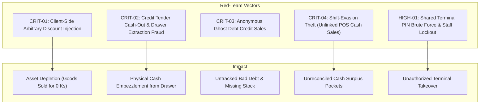

# Forensic Red-Team, Concurrency & Enterprise Business Logic Audit (V2)

**Repository:** DOT Enterprise POS, Workshop & ERP Backend API (Laravel 11)  
**Date:** 2026-10-30  
**Target:** Critical Vulnerability Assessment, Concurrency Deadlocks, Financial Fraud Vectors, and Complete 43-Model CRUD Coverage  
**Audit Approach:** Unvarnished, Brutally Honest Architectural & Codebase Inspection (No Sugarcoating / Direct Blaming)

---

## 1. Executive Summary & Forensic Verdict

Following the completion of Phases 1, 2, and 3, a deep-dive forensic inspection of the codebase was executed across all controllers, domain actions, models, form requests, database transactions, and business calculations.

### The Verdict:
Although the basic CRUD endpoints and primary transaction paths are operational (133 tests passing), the server currently harbors **critical enterprise business logic flaws, severe cashier cash-out fraud vectors, lock ordering inversions leading to database deadlocks, client-side arbitrary discount tampering, and orphan audit log infrastructure**.

In an enterprise deployment with multi-counter POS terminals and multi-branch inventory, **these flaws would lead to immediate cash register discrepancies, physical cash theft, inventory ledger desynchronization, and database deadlocks under high load**.

---

## 2. Red-Team Attack & Fraud Exploitation Matrix



---

## 3. Deep Forensic Blaming & Vulnerability Breakdown

### 🚨 CRITICAL FRAUD & SECURITY VULNERABILITIES

#### [CRIT-01] Arbitrary Client-Controlled Discount Vulnerability (Checkout Bypass)
* **Location:** `app/Http/Requests/V1/CheckoutRequest.php` & `app/Domains/SalesAndPos/Actions/ProcessCheckoutAction.php` (Line 139).
* **The Code:**
  ```php
  // CheckoutRequest.php
  'discount_amount' => ['nullable', 'numeric', 'min:0'],

  // ProcessCheckoutAction.php
  $discountTotal = (float) ($data['discount_amount'] ?? 0.00);
  $taxTotal = (float) ($data['tax_amount'] ?? 0.00);
  $totalAmount = max(0, round($calculatedSubtotal - $discountTotal + $taxTotal, 2));
  ```
* **The Blame & Exploit:**
  While line-item prices have anti-tampering guards, the order-level `discount_amount` is accepted **blindly without any manager PIN, permission check, or promotional campaign validation**.
  An untrusted cashier or external API caller can checkout a 1,000,000 Ks cart, pass `discount_amount: 999,000`, pay 1,000 Ks in cash, and walk away with 1,000,000 Ks of goods legally stamped as "Completed".
* **Enterprise Invariant Violated:** Order-level discretionary discounts must strictly require supervisor authorization (`pos.applyDiscount` or `manager_pin`), or link to an active `promotions` record with validity dates.

---

#### [CRIT-02] Cash Register Drawer Extraction / Physical Cash-Out Fraud via Credit Tender
* **Location:** `app/Domains/SalesAndPos/Actions/ProcessCheckoutAction.php` (Lines 147-165).
* **The Code:**
  ```php
  foreach ($paymentSplits as $split) {
      $splitAmt = (float) ($split['amount'] ?? 0.00);
      if (strtolower($split['method'] ?? '') === 'credit') {
          $dueAmount += $splitAmt;
      } else {
          $paidAmount += $splitAmt;
      }
  }

  $totalTendered = round($paidAmount + $dueAmount, 2);
  $changeAmount = max(0.00, round($totalTendered - $totalAmount, 2));
  ```
* **The Blame & Exploit:**
  `totalTendered` combines both real cash/card payments AND deferred customer credit debt. If a customer buys 20,000 Ks of goods, a dishonest cashier enters `method: "credit"`, `amount: 120,000 Ks`.
  The server calculates `$changeAmount = 100,000 Ks`!
  The cashier pops open the physical cash drawer and pockets 100,000 Ks in physical currency, while charging 120,000 Ks of debt to the customer's account!
* **Enterprise Invariant Violated:** Credit debt and non-cash tenders can **NEVER** generate physical cash change. Change amount must strictly originate from cash overpayment:
  $$\text{Change Amount} = \max(0, \text{Cash Tendered} - (\text{Order Total} - \text{Non-Cash Payments}))$$
  Furthermore, `dueAmount` cannot exceed `totalAmount - paidAmount`.

---

#### [CRIT-03] "Ghost Debt" Anonymous Credit Sale Vulnerability
* **Location:** `app/Domains/SalesAndPos/Actions/ProcessCheckoutAction.php` (Lines 168-180 & Line 209).
* **The Code:**
  ```php
  $customer = null;
  if ($customerId) {
      $customer = Customer::where('id', $customerId)->lockForUpdate()->first();
      if ($customer && $dueAmount > 0) {
          // Debt added to customer
      }
  }

  $salesOrder = SalesOrder::create([
      'order_no' => $orderNo,
      'customer_id' => $customerId ?? 1, // Fallback to walk-in customer 1
      'due_amount' => $dueAmount,
      ...
  ]);
  ```
* **The Blame & Exploit:**
  If a client sends `customer_id: null` with `payments: [{ method: "credit", amount: 50000 }]`, `if ($customerId)` evaluates to `false`.
  No customer credit limit is checked, and no customer debt ledger is updated.
  However, the order is created with `customer_id: 1` and `due_amount: 50,000 Ks`. The stock leaves the warehouse, but Customer 1's profile balance is untouched! This leaves a **ghost debt** that is impossible to collect or reconcile.
* **Enterprise Invariant Violated:** Any transaction containing a `credit` payment split **MUST strictly mandate a valid, registered customer ID**. Credit sales to anonymous walk-in customers must be blocked with `422 Unprocessable Entity`.

---

#### [CRIT-04] Shift-Evasion Theft Loophole (Unregistered Cash Sales)
* **Location:** `app/Domains/SalesAndPos/Actions/ProcessCheckoutAction.php` (Lines 43-48 & 203-205).
* **The Code:**
  ```php
  $activeSession = PosSession::where('cashier_id', $cashierId)->where('status', 'open')->first();
  $sessionId = $data['pos_session_id'] ?? $activeSession?->id;
  // If activeSession is null and pos_session_id is null, $sessionId remains NULL!
  ```
* **The Blame & Exploit:**
  A cashier can complete sales without opening a cash register shift!
  If a cashier never calls `POST /api/v1/pos/sessions/open`, orders are saved with `pos_session_id: null`.
  At the end of the day, when managers review Shift Reports and Z-Reports, **none of those sales appear in any drawer reconciliation formula**. The cashier simply takes the cash home.
* **Enterprise Invariant Violated:** In retail and workshop POS systems, cashiers **CANNOT execute transactions without an active, open shift session**.

---

#### [HIGH-01] O(N) Shared-Terminal PIN Brute-Force & Staff Lockout
* **Location:** `app/Http/Controllers/Api/V1/AuthController.php` (Lines 88-96).
* **The Code:**
  ```php
  // Limited candidate pool of active staff members
  $candidates = StaffUser::with('role')->where('status', 'Active')->limit(20)->get();

  foreach ($candidates as $staff) {
      if ($staff->pin_hash && Hash::check($request->pin, $staff->pin_hash)) {
          $matchedStaff = $staff;
          break;
      }
  }
  ```
* **The Blame & Exploit:**
  1. **Arbitrary Lockout:** If an enterprise has 30 staff members, any staff member with ID > 20 is completely omitted from the query and **cannot log in with PIN**.
  2. **Identity Hijacking:** If two employees have the same PIN (or default PIN), the system always authenticates the employee with the lowest ID, logging in under the wrong identity and falsifying audit trails.
* **Enterprise Invariant Violated:** PIN verification on POS terminals must be deterministic: either require selecting the staff profile / entering staff code (`staff_id` + `pin`), or scan a cashier barcode badge.

---

### ⚠️ BUSINESS LOGIC, ACCOUNTING & CONCURRENCY FLAWS

#### [BIZ-01] Loyalty Point Burn without Price Deduction
* **Location:** `app/Domains/SalesAndPos/Actions/ProcessCheckoutAction.php` (Lines 183-197).
* **The Blame:**
  When a customer redeems 100 loyalty points (`points_redeemed: 100`), the points are decremented from `customers.loyalty_points`.
  However, **`totalAmount` is calculated strictly from line items without deducting any monetary equivalent for the redeemed points**.
  The customer loses their points, yet pays the exact same bill!
* **Remediation:** Establish a configurable conversion rate (e.g. 1 point = 100 Ks), automatically deduct $(\text{points\_redeemed} \times \text{rate})$ from `totalAmount`, and record `points_discount_amount`.

---

#### [BIZ-02] Silent Inventory Drift on Unallocated Warehouse Location
* **Location:** `app/Domains/Inventory/Actions/DeductStockAction.php` (Lines 72-89).
* **The Blame:**
  When checking out from a specific warehouse (`warehouse_id`), if no `WarehouseStock` record exists for that product, `if ($whStock)` simply evaluates to `false`.
  `products.stock` is decremented, but **zero stock is decremented from the warehouse, and no exception is thrown**.
  The physical branch inventory and master catalog silently diverge, corrupting inventory audits.
* **Remediation:** If `warehouse_id` is supplied, `WarehouseStock` row lock must be strictly enforced. If missing, fail with `InsufficientStockException: Product not allocated in this warehouse`.

---

#### [BIZ-03] Fatal 500 Crash on Negative Stock Adjustment Attempt
* **Location:** `app/Http/Controllers/Api/V1/StockAdjustmentController.php` (Lines 56-61 & Line 105).
* **The Code:**
  ```php
  $adjustment = DB::transaction(function () use ($validated, $staffId) {
      if ($newStock < 0) {
          return response()->json(['success' => false, ...], 422);
      }
      ...
      return StockAdjustment::create(...);
  });

  return (new StockAdjustmentResource($adjustment))->response()->setStatusCode(201);
  ```
* **The Blame:**
  Inside `DB::transaction()`, returning a `JsonResponse` passes a `JsonResponse` object into `new StockAdjustmentResource($adjustment)`.
  This triggers a PHP Fatal `TypeError: Cannot access property on JsonResponse`, crashing the request with a **500 Internal Server Error** instead of returning a clean 422 JSON validation error.
* **Remediation:** Throw a `DomainException("Negative stock violation...")` inside the transaction and catch it in the controller.

---

#### [BIZ-04] Workshop Labor Item Ledger Omission
* **Location:** `app/Domains/Workshop/Actions/ConvertWorkOrderToInvoiceAction.php` (Lines 158-167).
* **The Blame:**
  When converting a Job Card with a labor fee to an invoice, it searches for `Product::where('is_labor', true)->first()`.
  If no labor product is seeded or configured, **no line item is created for the labor fee**, yet `sales_orders.total_amount` includes the labor fee.
  The sum of `sales_order_items.subtotal` does not match `sales_orders.total_amount`, violating double-entry and invoice itemization standards.
* **Remediation:** Throw an explicit exception if labor service product is not configured, or automatically generate an itemized system labor line item.

---

#### [CONC-01] Cross-Table Lock Inversion Deadlock (Products vs Customers)
* **Location:** `app/Domains/SalesAndPos/Actions/ProcessCheckoutAction.php` (Lines 86 & 170).
* **The Blame:**
  In `ProcessCheckoutAction`, catalog products are locked first in lines 52-86 (`DeductStockAction`).
  The customer row is locked later at line 170 (`Customer::where('id', $customerId)->lockForUpdate()`).
  If a concurrent customer credit settlement or debt query locks `customers` first and then queries `products`, a circular wait deadlock occurs (AB-BA lock order).
* **Remediation:** Establish a strict, global lock acquisition hierarchy:
  1. `customers` row lock (highest level)
  2. `products` rows in ascending `id` order
  3. `warehouse_stocks` rows in ascending `id` order

---

## 4. Comprehensive 43-Model CRUD Completeness Audit

| # | Model | Domain | Table | Controller / Exposure | CRUD Coverage | Forensic Audit & Blaming Verdict |
| :---: | :--- | :--- | :--- | :--- | :---: | :--- |
| **1** | `Attribute` | Inventory | `attributes` | `AttributeController` | **Partial (60%)** | `index`, `store`, `show`. Missing `update` and `destroy`. |
| **2** | `AttributeValue` | Inventory | `attribute_values` | `AttributeController` | **Partial (60%)** | Managed via attribute. No standalone value deletion guard. |
| **3** | `AuditLog` | SecurityAndAudit | `audit_logs` | **None (0%)** | ❌ **Orphan Table** | **ZERO API endpoints!** Audit logs are written across all actions, but no admin/auditor can query them via API. |
| **4** | `Category` | Inventory | `categories` | `CategoryController` | **Full (100%)** | Full CRUD with relational child product guards. |
| **5** | `CreditSettlement` | CreditAndLedger | `credit_settlements` | `CustomerCreditController` | **Partial (60%)** | Can settle per customer, but **NO global AR Collections Journal (`GET /credit-settlements`)**. |
| **6** | `Customer` | CreditAndLedger | `customers` | `CustomerController` | **Full (100%)** | Full CRUD, phone uniqueness, outstanding debt delete guards. |
| **7** | `Fleet` | CreditAndLedger | `fleets` | `FleetController` | **Full (100%)** | Full CRUD with linked vehicle/customer deletion guards. |
| **8** | `HeldOrder` | SalesAndPos | `held_orders` | `PosController` | **Full (95%)** | Park, list, delete with shift and cashier scoping. |
| **9** | `Mechanic` | Workshop | `mechanics` | `MechanicController` | **Full (100%)** | Full CRUD with active job card deletion guards. |
| **10**| `MechanicCommission`| Workshop | `mechanic_commissions`| `MechanicController` | **Full (95%)** | Listing per mechanic and transactional payout disbursement. |
| **11**| `OutsourcedPart` | Workshop | `outsourced_parts` | `OutsourcedPartController` | **Full (100%)** | Full CRUD with cost, bill price, and margin calculations. |
| **12**| `PaymentSplit` | SalesAndPos | `payment_splits` | Managed via Order | **Embedded (90%)** | Split tracking functional, but lacks per-split change/tendered tracking. |
| **13**| `PaymentTransaction` | SalesAndPos | `payment_transactions`| `PaymentGatewayController`| **Full (95%)** | Dynamic QR generation, HMAC webhook verification, status queries. |
| **14**| `PosSession` | SalesAndPos | `pos_sessions` | `PosSessionController` | **Full (95%)** | Open, close, blind count variance, X/Z-Reports. Missing admin force-close. |
| **15**| `PriceList` | Pricing | `price_lists` | `PriceListController` | **Full (100%)** | Full CRUD with wholesale items and volume breaks. |
| **16**| `PriceListItem` | Pricing | `price_list_items` | `PriceListController` | **Embedded (100%)** | Fully managed via parent price list. |
| **17**| `Product` | Inventory | `products` | `ProductController` | **Full (100%)** | Full CRUD, barcode search, auto warehouse allocation, sales history guard. |
| **18**| `ProductOption` | Inventory | `product_options` | **None (0%)** | ⚠️ **Legacy Orphan** | Deprecated in favor of `ProductVariant`, but remains in schema and deduction logic. |
| **19**| `ProductUomConversion`| Inventory | `product_uom_conversions`| `ProductUomConversionController`| **Partial (75%)** | `index`, `store`, `destroy`. Missing `update` for pricing/barcode adjustments. |
| **20**| `ProductVariant` | Inventory | `product_variants` | `ProductController` | **Partial (50%)** | Matrix generation works, but **NO individual variant update/delete (`PUT /products/{id}/variants/{id}`)**. |
| **21**| `ProductVehicleFitment`| Inventory | `product_vehicle_fitments`| `VehicleFitmentController` | **Full (90%)** | Fitment matrix, compatible parts query, catalog reverse search. |
| **22**| `Promotion` | Pricing | `promotions` | `PromotionController` | **Full (100%)** | Full CRUD with date ranges, discount types, and tier targeting. |
| **23**| `Purchase` | Purchasing | `purchases` | `PurchaseController` | **Partial (75%)** | `index`, `store`, `show`, `receive`, `cancel`. **Missing `update` for draft purchase orders**. |
| **24**| `PurchaseItem` | Purchasing | `purchase_items` | Managed via Purchase | **Embedded (90%)** | Multi-item purchase lines functional. |
| **25**| `PurchaseReturn` | Purchasing | `purchase_returns` | `PurchaseReturnController` | **Full (100%)** | Return to Vendor (RTV) with stock decrement and supplier debt credit. |
| **26**| `Role` | SecurityAndAudit | `roles` | `RoleController` | **Full (100%)** | Full CRUD with system role protection and permissions catalog. |
| **27**| `SalesOrder` | SalesAndPos | `sales_orders` | `PosController` | **Full (95%)** | Checkout, order listing, show, reprint, and supervisor order voiding. |
| **28**| `SalesOrderItem` | SalesAndPos | `sales_order_items` | Managed via Order | **Embedded (95%)** | UOM packaging, variant linking, cost/price tracking. |
| **29**| `SalesReturn` | SalesAndPos | `sales_returns` | `SalesReturnController` | **Full (95%)** | Return with sellable restock, scrap quarantine, credit debt reversal. |
| **30**| `SalesReturnItem` | SalesAndPos | `sales_return_items` | Managed via Return | **Embedded (95%)** | Multi-item return lines functional. |
| **31**| `StaffUser` | SecurityAndAudit | `staff_users` | `StaffController` | **Full (100%)** | Full CRUD, PIN hashing, token revocation on suspension. |
| **32**| `StockAdjustment` | Inventory | `stock_adjustments` | `StockAdjustmentController` | **Partial (60%)** | `index`, `store`. **Missing `show` for individual voucher audit**. |
| **33**| `StockTransfer` | Inventory | `stock_transfers` | `StockTransferController` | **Full (95%)** | Two-step dispatch and receive with transit loss accounting. |
| **34**| `StockTransferItem` | Inventory | `stock_transfer_items` | Managed via Transfer | **Embedded (90%)** | Quantities dispatched vs received tracking. |
| **35**| `Supplier` | Purchasing | `suppliers` | `SupplierController` | **Full (100%)** | Full CRUD with outstanding debt tracking and purchase history guard. |
| **36**| `SystemSequence` | SalesAndPos | `system_sequences` | Internal Service | **Internal (100%)** | ACID-safe atomic sequential numbering (`INV`, `PO`, `PRTN`, `RET`). |
| **37**| `UnitOfMeasure` | Inventory | `units_of_measure` | `UnitOfMeasureController` | **Full (100%)** | Full CRUD with base UOM in-use deletion guards. |
| **38**| `User` | Authentication | `users` | Default Laravel Auth | **Legacy (30%)** | Unused legacy table coexisting with `StaffUser`. Creates architectural confusion. |
| **39**| `Vehicle` | Workshop | `vehicles` | `VehicleController` | **Full (100%)** | Full CRUD, plate number uniqueness, customer linking, active job guard. |
| **40**| `Warehouse` | Inventory | `warehouses` | `WarehouseController` | **Full (100%)** | Full CRUD, branch code uniqueness, stock listing per warehouse. |
| **41**| `WarehouseStock` | Inventory | `warehouse_stocks` | `WarehouseController` | **Partial (60%)** | Accessible via `warehouses/{id}/stocks`. No direct physical stock count reconciliation API. |
| **42**| `WorkOrder` | Workshop | `work_orders` | `WorkOrderController` | **Full (95%)** | Full CRUD, state transitions, invoice conversion, Reverb broadcasts. |
| **43**| `WorkOrderItem` | Workshop | `work_order_items` | Managed via WorkOrder | **Embedded (90%)** | Parts, labor, outsourced lines functional. |

---

## 5. Prioritized Remediation Roadmap

```mermaid
flowchart TD
    subgraph Stage 1: Financial & Fraud Hotfixes
        S1_1["Mandatory Active Shift Session for Checkout"]
        S1_2["Disallow Non-Cash Overpayment & Cashier Cash-Out"]
        S1_3["Require Registered Customer for Credit Sales"]
        S1_4["Server-Side Discount Authorization / Manager PIN"]
    end

    subgraph Stage 2: Concurrency & Exception Fixes
        S2_1["Fix StockAdjustmentController 500 on Negative Stock"]
        S2_2["Global Lock Hierarchy: Customers -> Products -> WarehouseStock"]
        S2_3["Strict Warehouse Stock Row Lock in DeductStockAction"]
    end

    subgraph Stage 3: Operational CRUD Completeness
        S3_1["AuditLog API: GET /api/v1/audit-logs with Filters"]
        S3_2["Accounts Receivable Collections API: GET /api/v1/credit-settlements"]
        S3_3["Draft Purchase Order Update API: PUT /api/v1/purchases/{id}"]
        S3_4["Individual Product Variant API: PUT /products/{id}/variants/{variantId}"]
    end

    Stage 1 --> Stage 2 --> Stage 3
```

### Stage 1: Anti-Fraud & Accounting Invariant Hotfixes (Immediate)
1. **Enforce Open Shift Session on Checkout:**
   In `ProcessCheckoutAction`, throw `DomainException("Cannot checkout without an active shift session")` if `$sessionId` is null.
2. **Eliminate Non-Cash Change Extraction:**
   Calculate `cashTendered` strictly from `split.method === 'cash'`. Ensure `change_amount` can never exceed cash paid minus net balance. Block credit amounts greater than `totalAmount - otherPayments`.
3. **Block Anonymous Credit Sales:**
   In `CheckoutRequest` and `ProcessCheckoutAction`, validate that `dueAmount > 0` strictly requires `customer_id` (and customer cannot be default walk-in guest ID 1).
4. **Authorize Order Discounts:**
   In `ProcessCheckoutAction`, reject `discount_amount > 0` unless authorized by `manager_pin` or an authenticated user with `pos.applyDiscount` permission.

### Stage 2: Concurrency & Exception Hardening (Short Term)
1. **Fix `StockAdjustmentController`:**
   Throw a `DomainException` inside `DB::transaction()` instead of returning a `JsonResponse` to eliminate the PHP TypeError crash.
2. **Prevent Deadlocks:**
   Lock `Customer` before locking `Product` rows in `ProcessCheckoutAction`.
3. **Prevent Warehouse Stock Drift:**
   In `DeductStockAction`, throw `InsufficientStockException` if the product has no stock allocation in the specified warehouse location.

### Stage 3: Missing CRUD & Audit Log Exposure (Medium Term)
1. **Audit Logs API (`AuditLogController`):** Expose `GET /api/v1/audit-logs` restricted to `settings.manageRoles` with module, action, date, and staff filters.
2. **AR Collections Journal:** Expose `GET /api/v1/credit-settlements` for cross-counter daily debt collection reconciliation.
3. **Draft Purchase Order Editing:** Expose `PUT /api/v1/purchases/{id}` allowing procurement officers to update quantities and costs before receiving goods.
4. **Individual Variant Management:** Expose `PUT /api/v1/products/{id}/variants/{variantId}` for surgical price and barcode adjustments.
